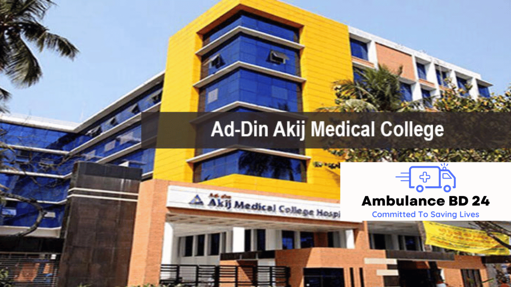

Ad Din Hospital’s ambulance service in Khulna is an essential component of their healthcare offerings, providing a rapid and reliable response in emergency situations. As an accredited and award-winning hospital, Ad Din has established a reputation for quality care in the region. In this article, we will explore all aspects of Ad-Din Hospital’s ambulance service in Khulna, including its history, facilities, and [technology](/technology-used-for-ambulance-in-bangladesh/). We will also discuss the importance of ambulance services in emergency situations and the significance of Ad-Din Hospital’s [ambulance service](/) in providing effective healthcare solutions.

## Ad Din Hospital

[Ad Din Hospita](https://ad-din.org/ad-din-akij-medical-college-hospital-aamch-boyra-khulna/)l is a famous healthcare institution in Khulna that offers a wide range of medical services. It has [history](https://ad-din.org/about/history/), It was established in 1980 by a group of philanthropists led by Dr. A. R. Mallick. The hospital started its journey with only 20 beds, but over the years, it has grown to become a major healthcare provider in the country, with more than 500 beds spread across different locations. Ad-Din Hospital offers a wide range of services, including general medicine, surgery, paediatrics, obstetrics and gynaecology, ophthalmology, orthopaedics, and more. The hospital has also established a number of satellite clinics and health centres to reach out to the rural population. Ad-Din Hospital’s mission is to provide affordable, quality healthcare services to all, regardless of their socioeconomic status.

Ad-Din Hospital has received several accreditations and awards, which is a testament to the quality of care it provides. The hospital is committed to continuous improvement and innovation and uses data-driven approaches to monitor and improve patient outcomes. Ad-Din Hospital is also actively involved in research and education, which helps to advance medical knowledge and improve healthcare delivery in the region.

Ad-Din Hospital offers a wide range of medical services, including cardiology, neurology, oncology, orthopaedics, paediatrics, and more. The hospital has specialized departments for various medical conditions and uses a multidisciplinary approach to provide comprehensive care to patients. Ad-Din Hospital is committed to providing affordable healthcare services to all, and offers various payment options and financial assistance programs to help patients cover the cost of medical care.

## Ambulance Service at Ad Din Hospital Khulna

Ad Din Hospital in Khulna offers a top-notch ambulance service that is available 24/7. The hospital has a fleet of well-equipped ambulances with advanced medical equipment, and is staffed by highly trained and experienced personnel who are ready to provide emergency medical assistance whenever needed.

The ambulance service at Ad Din Hospital in Khulna offers multiple types of ambulances to cater to different types of emergencies, such as basic life support ambulances, advanced life support ambulances, and neonatal ambulances. The hospital’s ambulances are also GPS-enabled, which helps them to reach the emergency site quickly and efficiently.

The hospital’s ambulances have ventilators, defibrillators, and oxygen supply systems. This lets ambulance crews treat critically ill patients on the way to the hospital.

Paramedics and EMTs staff Ad Din Hospital’s [ambulance service in Khulna](/inter-district-ambulance-service/). The staff can offer CPR, oxygen therapy, and medication.

Ad Din Hospital in Khulna offers economical ambulance service with clear pricing and billing. The hospital’s ambulance service works with other hospitals and emergency services to transfer patients smoothly.

Call Ad Din Hospital in Khulna’s emergency hotline to request an ambulance. Requests should include the emergency’s location, the patient’s status, and any pertinent information. Preparing for an emergency can speed response and improve outcomes.

Ad Din Hospital’s 24/7 ambulance service in Khulna is trustworthy and effective. Ad Din Hospital’s ambulance service in Khulna is trusted for emergency care due to its superior equipment, trained staff, and cooperation with other healthcare providers.

## Features and Benefits of ad din Hospital’s ambulance Service

The ambulance service provided by Ad Din Hospital in Khulna has a variety of features and benefits, which combine to make it a trustworthy and convenient choice for use in urgent circumstances. The following is a list of some of the features and advantages that you might anticipate:

1.  **24/7 Availability and Response**

-   Ad Din Hospital ambulance service is available 24/7, so you can always reach out to them for help in case of an emergency.
-   With their quick arrival time, you can be assured that help will be on the way as soon as possible.

2.  **GPS-Enabled Ambulance Service**

-   Ad Din Hospital’s ambulance service uses GPS technology to locate the patient’s location accurately.
-   This helps the ambulance reach the patient’s location faster and ensures timely medical assistance.

3.  **Well-Equipped Ambulances with Advanced Medical Equipment**

-   Ad Din Hospital’s ambulances are well-equipped with advanced medical equipment such as oxygen supply, cardiac monitors, and defibrillators.
-   This allows the ambulance staff to provide critical care services to the patient on their way to the hospital.

4.  **Highly Trained and Experienced Staff and Medical Personnel**

-   The ambulance staff and medical personnel at Ad Din Hospital are highly trained and experienced in handling emergency situations.
-   They are equipped to provide basic life support, advanced life support, and critical care services as needed.

5.  **Affordable Pricing and Billing Transparency**

-   Ad Din Hospital’s ambulance service offers affordable pricing and billing transparency.
-   You can expect no hidden charges or surprises in your billing, making it easy for you to plan your expenses.

6.  **Working with Other Healthcare Providers and Emergency Services**

-   Ad Din Hospital’s ambulance service has partnerships with other healthcare providers and emergency services.
-   This helps ensure seamless transfer of patients between hospitals, as well as access to specialized medical care.

## How to Request Ad Din Hospital Ambulance Service?

When you’re faced with a medical emergency, it’s important to move quickly and get the help you need. Ad Din Hospital ambulance service in Khulna is open 24/7 to provide immediate assistance in emergency situations. To order ambulance service, you can call their dedicated hotline at \[phone number\], or visit their website and fill out the online form.

[When making a call for ambulance service](/you-should-know-before-calling-an-ambulance/), it’s important to provide as much information as possible. This includes the location of the emergency, the nature of the medical condition or injury, and any other relevant information. Ad Din Hospital ambulance service uses GPS-enabled ambulances, which helps them to locate the emergency fast and efficiently.

The staff and medical personnel at Ad-Din Hospital ambulance service are highly trained and experienced in handling emergency cases. They use advanced medical equipment and technology to provide instant care and support to patients. In addition, the ambulance service is cheap and offers transparent billing, so you can be confident in the pricing of the service.

It’s important to prepare for emergency situations by having a list of emergency contact numbers, including Ad-Din Hospital ambulance service in Khulna. This can help you move quickly in the event of an emergency and ensure that you get the medical help you need.

Ad-Din Hospital ambulance service in Khulna is a reliable and efficient way to get emergency medical help. By calling their hotline or checking their website, you can quickly request ambulance service and receive immediate care from highly trained medical professionals.

In conclusion, Ad Din Hospital’s ambulance service in Khulna offers a reliable, efficient, and affordable option for emergency medical situations. The service offers advanced medical equipment, GPS-enabled ambulances, and highly trained staff and medical personnel, ensuring that patients receive the right care during their transportation to the hospital. The hospital’s relationship with other healthcare providers and emergency services also helps to ensure a seamless experience for patients. By using Ad Din Hospital’s ambulance service, patients can have peace of mind knowing that they are in good hands and will receive timely and appropriate medical care. In the fast-paced world we live in, having access to reliable ambulance services is important for ensuring the health and well-being of our loved ones. Ad Din Hospital’s ambulance service in Khulna is an excellent choice for anyone looking for dependable emergency medical transportation.

## ad din hospital Khulna doctor list

Ad Din Hospital in Khulna is one of the most renowned healthcare institutions in the region. It offers a wide range of medical services and specialties, from general medicine and surgery to pediatrics, gynecology, and more. If you’re looking for a doctor at Ad Din Hospital in Khulna, here is a list of some of the top specialists you can consult:

1.  **Dr. M. A. Matin (MBBS, FCPS):** Dr. Matin is a highly experienced specialist in gynecology and obstetrics. He has been practicing for over 20 years and is known for his compassionate care and expertise in handling complicated cases.
2.  **Dr. Md. Nazrul Islam (MBBS, FCPS, MS):** Dr. Islam is a skilled surgeon with a focus on urology. He is known for his ability to handle complex procedures with ease and has helped numerous patients recover from various urological conditions.
3.  **Dr. Rumana Nasrin (MBBS, DGO, FCPS):** Dr. Nasrin is a specialist in gynecology and obstetrics, with over 15 years of experience. She is known for her friendly and caring approach to patients and her ability to handle complex cases with ease.
4.  **Dr. Ahsan Habib (MBBS, FCPS):** Dr. Habib is a highly skilled specialist in cardiology, with a focus on interventional cardiology. He is known for his expertise in handling complex cardiac cases and has helped numerous patients recover from various heart conditions.
5.  **Dr. Mohammad Abdur Rouf (MBBS, FCPS):** Dr. Rouf is a renowned specialist in gastroenterology and hepatology, with over 15 years of experience. He is known for his expertise in handling complicated cases of liver and digestive disorders.

These are just a few of the many skilled and experienced doctors you can consult at Ad Din Hospital in Khulna. Whether you need general medical care or specialized treatment for a particular condition, Ad Din Hospital has the expertise and resources to provide you with the right care.

## Ad-din Hospital Khulna ambulance number

Ad-din Hospital Khulna ambulance number is listed on the hospital's official website. Ad-din Hospital in Khulna offers emergency ambulance services to help patients reach the hospital safely and quickly. If you require an ambulance, you can contact Ad-din Hospital Khulna’s ambulance service at see the hospital's official website. The ambulance service is available 24/7, and the experienced team is well-equipped to handle emergencies and provide immediate medical assistance en route to the hospital. With a focus on patient care and safety, Ad-din Hospital Khulna’s ambulance service is committed to providing reliable and prompt service to those in need.

In conclusion, Ad Din Hospital in Khulna, Bangladesh is a renowned healthcare institution that provides quality care to patients in the region. The hospital’s ambulance service is an essential component of its healthcare offerings and is available 24/7 to provide emergency medical assistance. The service has a fleet of well-equipped ambulances with advanced medical equipment and is staffed by highly trained and experienced personnel. The ambulance service is GPS-enabled and offers various types of ambulances to cater to different types of emergencies. Ad Din Hospital’s ambulance service is affordable, transparent, and works with other healthcare providers and emergency services. With its 24/7 availability, quick arrival time, advanced technology, and trained personnel, Ad Din Hospital’s ambulance service in Khulna is a trustworthy and convenient choice for use in urgent circumstances.
