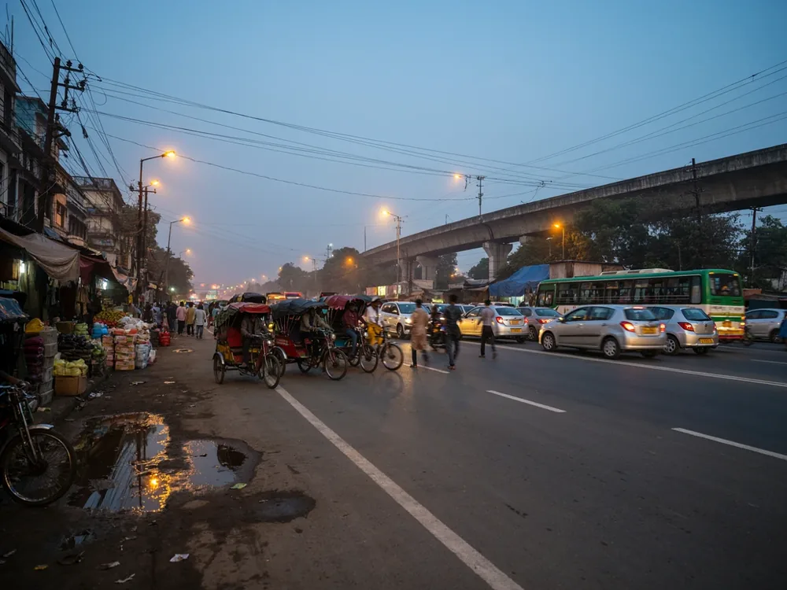

**Three things decide an ambulance fare in Dhaka: how far it goes, which vehicle the patient needs, and how long it waits. Before the ambulance moves, ask for the total on the call. We tell you the fare before we dispatch. Call us with the pickup, the destination and how the patient is.**

<a href="tel:+8801919339689" class="inline-flex min-h-12 items-center gap-2 rounded-full bg-call px-6 font-heading font-bold text-white! no-underline!" data-placement="post-intro">Call 01919-339689 — 24/7</a>

<aside aria-label="Quick answer" class="rounded-[24px] bg-(--blue-soft) p-6 text-(--ink)"><strong>Quick answer.</strong> An ambulance fare in Dhaka is set by distance, vehicle type, waiting time, extra stops, tolls, the return trip and the time of day. Ask for the total on the call, and ask what it covers. We tell you the fare before we dispatch.</aside>

In an emergency, call first. This page is for the moment after, when you want to know what the number on the phone is made of. It is general guidance, not medical advice.

## What decides an ambulance fare in Dhaka

No two trips are the same, so no two fares are the same. These are the parts that move an ambulance price, and how each one can change the total. We give no figures here. The fare depends on your trip, and we confirm it on the call.

- **Distance.** A longer run means more fuel and more hours for the vehicle and the driver. Some providers use a flat fare inside the city and a rate per km outside it. Ask which one applies, and where the distance is counted from.
- **Vehicle type.** A basic ambulance, an AC ambulance, a vehicle set up for intensive care and a freezer van are different machines. The more a vehicle is set up to do, the more expensive it is to run, and the fare usually reflects that. Choose the type the treating doctor advises. Do not pay for more than the patient needs, and do not travel with less.
- **Waiting time.** A discharge can take hours, and so can a queue at a hospital gate. While the ambulance waits, it cannot take another trip. Ask whether a waiting charge applies, when it starts and how it is counted.
- **Extra stops.** A pharmacy, a second hospital, a relative's home. Each stop adds distance and time. Tell the dispatcher about every stop at the start, so it is in the fare. A stop added halfway can change the total.
- **Tolls.** Bridge and highway tolls matter mostly on long trips. Ask whether tolls are inside the quoted fare or paid on top, so you are not surprised at the toll booth.
- **Return trip.** On a trip out of Dhaka the vehicle has to come back. Some quotes cover one way only, some cover the round trip. Ask which, in plain words.
- **Time of day.** Some providers charge differently at night or on holidays. Ask whether the time of day changes the fare. Do not assume that it does or does not.

The total is the sum of these parts. Your job is to make sure each part is named before the ambulance moves.

## 6 things to confirm before the ambulance moves

1. **The total fare, as one number.** A rate per km means little until it becomes a total you can plan around.
2. **What the fare covers.** Which of distance, waiting, tolls and stops are in, and which are extra. "Included" and "extra" are where most arguments start.
3. **Waiting time.** Whether it is charged, when it starts and how it is counted. Discharge and gate queues are the hardest part of a trip to predict.
4. **Tolls and the return trip.** Whether they are in the total, and whether the quote is one way or round trip. These two decide most of a long-distance fare.
5. **The vehicle that is coming.** Its type, and whether it matches what the doctor advised. The wrong vehicle wastes money or comfort, and sometimes both.
6. **What happens if the trip changes.** An extra stop or a longer wait should mean a new fare agreed before you continue, not a surprise at the end.

Ask us any of them. We tell you the fare before we dispatch.

<a href="tel:+8801919339689" class="inline-flex min-h-12 items-center gap-2 rounded-full bg-call px-6 font-heading font-bold text-white! no-underline!" data-placement="post-mid">Call 01919-339689 — 24/7</a> <a href="https://wa.me/8801919339689" rel="noopener" class="inline-flex min-h-12 items-center gap-2 rounded-full bg-whatsapp px-6 font-heading font-bold text-white! no-underline!" data-placement="post-mid">WhatsApp for your fare</a>

## How fares differ by ambulance type

The vehicle is one of the biggest parts of the fare. In general terms, and without numbers:

- **[ICU ambulance](/icu-ambulance-service-dhaka/).** Set up for patients who need intensive care between hospitals. It is the more involved vehicle to run, so expect a higher fare than for a basic or AC ambulance. Only the treating doctor can say whether a patient needs one.
- **[AC ambulance](/ac-ambulance-service/).** Cooling adds to running expenses, most of all on long trips in Dhaka's heat. It is common for discharges, check-ups and comfortable transfers between hospitals.
- **[Freezer van](/freezer-ambulance-service/) (লাশবাহী ফ্রিজিং গাড়ি).** Used to take a loved one home. The fare follows the distance and any waiting, like any other trip, and a long journey to a district usually decides most of it. A family in grief should not have to bargain. Ask for the full fare, with any waiting, before the van leaves.
- **[Inter-district ambulance](/inter-district-ambulance-service/).** Distance leads, then tolls, waiting and whether the return trip is in the fare. The next section covers it.

## Dhaka to a district: what changes

Inside Dhaka, the fare is mostly a short run and the wait at the hospital. Out of Dhaka, the run itself becomes the fare.

- **Distance dominates.** A trip to a far district is hours of driving, not minutes, and the fare grows with it.
- **Tolls and crossings.** Bridges and highways on the route can add to the total. Ask if they are inside the quote.
- **The return trip.** The vehicle has to come back to Dhaka. Ask whether the quote is one way or round trip.
- **Waiting at the other end.** A discharge in a district hospital can take time. Ask how waiting is handled.
- **The route and the hour.** Road conditions and the time you leave change how long the trip takes.

Tell the dispatcher the district, the hospital, the date and what the doctor advised. For trips that stay inside the city, see the [areas of Dhaka we serve](/ambulance-service-areas-dhaka/).

If you live abroad and are arranging a trip for a parent, message us on WhatsApp with the district, the hospital and the doctor's advice, and ask for the fare. A family member at the bedside can confirm the pickup details by phone.

## Fare questions to ask any provider

These work with any ambulance service, not only ours.

- What is the total fare, as one number?
- What does it cover, and what is extra?
- Is waiting charged, and from when?
- Are tolls inside the fare?
- Is it one way or a round trip?
- Does the time of day change the fare?
- Will you tell me the fare before the vehicle leaves, and what happens if the trip changes?
- Who do I call if there is a problem on the way?

A provider that answers these plainly is easier to trust. One that avoids them is telling you something. More on choosing a service in [tips for finding a reliable ambulance service](/tips-to-find-ambulance-service/).

## What to tell our dispatcher so the fare is right

We send the nearest available ambulance. Around 10 minutes in central Dhaka, depending on traffic. The more the dispatcher knows at the start, the more exact the fare, and the fewer changes later. Please tell us:

- **Where the patient is now.** Area, road, a landmark, the floor, and whether there is a lift.
- **The patient's condition,** in a sentence, and what the treating doctor advised.
- **Whether oxygen is needed** on the way, as the doctor advised.
- **Stretcher or wheelchair.**
- **Pickup and destination.** Hospital names, the ward and the floor.
- **Every stop** you expect, so each one is in the fare.
- **One way or round trip,** for trips out of Dhaka.
- **A phone number** that stays on.

If you are not sure of something, say what you can see. We ask the rest. For a planned trip such as a discharge, a check-up or a district journey, call as early as you can: a fare is easier to settle when nothing is rushed. More on the call itself in [what to know before calling an ambulance](/you-should-know-before-calling-an-ambulance/).

*Pictures in this guide are illustrative AI-generated images, not photos of our vehicles or crew.*
