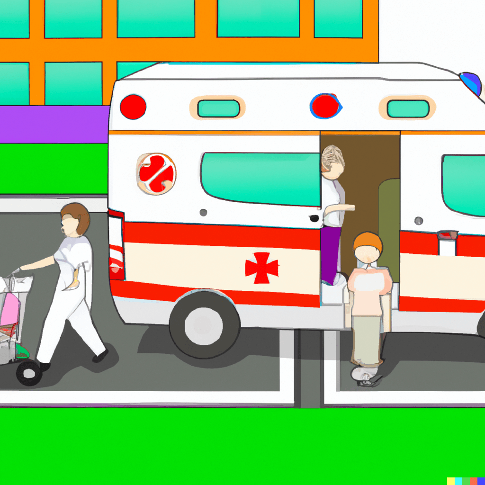

If you are injured or have a medical emergency, you may be able to get help from an ambulance. Ambulances can take people home from the hospital quickly and safely. Ambulances are also often faster than regular cars and can travel more quickly between hospitals.

## How can an ambulance help?

In the world of [emergency medical services](https://www.ems.gov/what-is-ems/), this question is asked all the time. In order to answer it, we need to understand what an ambulance does.

An ambulance is a vehicle designed and equipped for transporting sick or injured people to a hospital for medical treatment. It may also be used in some countries as a [fire engine](/why-do-fire-trucks-always-come-with-ambulances/) or police car, but it’s mainly used for transporting patients. Ambulances are usually staffed by paramedics who are specially trained to provide emergency care and first aid in the field.

The role of an ambulance is to transport people who are sick or injured and have no means of transportation to the nearest hospital. Ambulances are also used in the case of natural disasters, fires, and other public emergencies.

## Can an Ambulance pick-up You Home from the Hospital?

In most cases, the answer is yes. But if you are not in good enough health, then it’s better to call a taxi or ask someone to drive you home.

It is important to understand that an ambulance will not take you home if it’s unsafe for the ambulance to travel. For example, if the road is blocked and the ambulance cannot get through, they will not take you home.

Ambulances are required by law to transport patients without regard for their ability to pay. They can charge patients a fee for transporting them from their hospital bed back home but this varies from hospital to hospital.

### What Does the Law Say?

**If you’re in a hospital and need to go home, what are your options?**

If you have insurance, you may be able to go home by ambulance. If not, the law says that hospitals must provide transportation for patients who can’t afford to pay for an ambulance.

In some states, there are different rules for children. For example, in Texas children under 16 years of age can ride home with an adult family member or a friend if they don’t have anyone else to take them.

### What Are the Benefits?

[Ambulance service](/) is a transport service that provides emergency medical transport to patients who are in critical condition. The ambulance can take you to the hospital, but it cannot take you home.

**The benefits of an ambulance transport service include:**

-   Timely and efficient medical care
-   Confidentiality of medical information
-   Transportation to the hospital without having to pay for a taxi or other transportation costs
-   A professional, trained, and well-equipped staff
-   No waiting time at the hospital for appointments or tests

In conclusion, an ambulance may take you home from the hospital if you are in critical or life-threatening condition.
