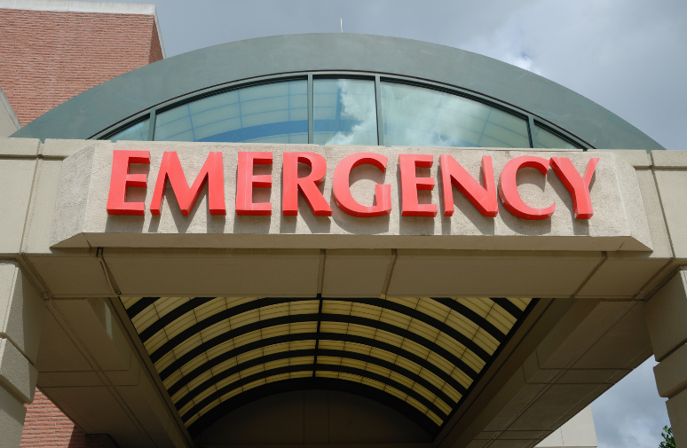

**Emergency medical services in Khulna** are organized and managed by the Khulna **district civil surgeon’s office. The office coordinates the deployment of ambulances, paramedics, and other medical personnel to ensure timely and effective emergency response in the region.**

Various government and non-government organizations also play a role in providing emergency [ambulance service Khulna](/inter-district-ambulance-service/), working in collaboration with the civil surgeon’s office to enhance the healthcare infrastructure and services. These organizations include the Department of Health, local hospitals, NGOs, and volunteer groups.

Together, they strive to deliver prompt medical assistance and save lives during emergencies in khulna, focusing on effective management and coordination of resources to maximize patient care.

## Introduction: Understanding The Importance Of Emergency Medical Services In Khulna

Emergency medical services play a crucial role in saving lives in the city of Khulna. When medical emergencies strike, quick and efficient medical assistance can mean the difference between life and death. In order to ensure the well-being of the residents, it is essential to have organized and well-managed emergency medical services in place.

Let’s delve into the importance of these services, the healthcare system in Khulna, and why proper organization and management are vital.

### The Role Of Emergency Medical Services In Saving Lives:

-   **Immediate response:** Emergency medical services provide prompt response in critical situations, ensuring that patients receive the necessary medical attention without delay.
-   **Life-saving interventions:** Trained professionals in emergency medical services are equipped to administer life-saving interventions such as cpr, defibrillation, and medication to stabilize patients before reaching the hospital.
-   **Effective triage:** Ems personnel are skilled in triage, enabling them to assess patients’ conditions and prioritize treatment accordingly.
-   **Transportation:** Ems teams are responsible for safely transporting patients to medical facilities, ensuring they receive the appropriate care as quickly as possible.

### A Brief Overview Of The Healthcare System In Khulna:

-   **Public and private healthcare facilities:** Khulna has a mix of public and private healthcare facilities, including hospitals, clinics, and specialized medical centers.
-   **Limited resources:** The healthcare system in khulna, like many developing regions, faces challenges such as limited funding, insufficient medical staff, and a lack of advanced medical equipment.
-   **Accessibility issues:** Some areas in khulna may face accessibility challenges, especially during emergencies, due to inadequate transportation infrastructure or geographical constraints.

### The Need For Organized And Well-Managed Emergency Medical Services:

-   **Timely response:** A well-organized emergency medical service ensures quick arrival times, reducing the risk of delayed medical aid.
-   **Streamlined coordination:** Proper management allows for seamless coordination between emergency responders, hospitals, and other healthcare providers, enhancing the overall efficiency of the system.
-   **Resource optimization:** Organized ems systems can effectively allocate resources, including ambulances, medical supplies, and manpower, optimizing their utilization for the benefit of the community.
-   **Continuous training and development:** Efficient management ensures that ems personnel receive regular training and are up-to-date with the latest medical practices, improving the quality of care provided.

It is evident that emergency medical services are a lifeline for the residents of khulna. With an organized and well-managed system in place, the city can ensure timely access to medical assistance and increase the chances of saving lives in critical situations.

## Key Stakeholders In Organizing And Managing Emergency Medical Services In Khulna

Emergency medical services (ems) are a critical component of any healthcare system, ensuring timely and efficient response to medical emergencies. In Khulna, a major city in Bangladesh, emergency medical services are organized and managed through the collaboration of various key stakeholders.

These stakeholders play a vital role in ensuring that emergency medical services are well-coordinated and accessible to the people in need. In this section, we will explore the key stakeholders involved in organizing and managing emergency medical services in khulna.

### Government Agencies Responsible For Emergency Medical Services

-   **Ministry of Health and family welfare (mohfw):** The mohfw is the primary government agency responsible for overseeing the healthcare system in Bangladesh. It plays a crucial role in formulating policies, providing guidance, and allocating resources for emergency medical services in khulna and other regions of the country.
-   **Directorate general of health services (dghs):** Under the [mohfw](http://www.mohfw.gov.bd/index.php?option=com_content&view=article&id=46%3Awelcome-to-ministry-of-health-and-family-welfare&catid=34%3Afontpage&Itemid=1&lang=en), the dghs is responsible for implementing and managing health services, including emergency medical services, in various districts of bangladesh, including khulna. It works closely with local authorities and healthcare providers to ensure the availability of trained medical professionals, necessary equipment, and infrastructure for emergency response.
-   **Khulna City Corporation (KCC):** As the local governing body, the [KCC](https://khulnacity.portal.gov.bd/) plays a significant role in organizing and managing emergency medical services within the city of Khulna. It works in collaboration with other government agencies to ensure quick arrival times, ambulance services, and the establishment of emergency care centers.

### Local Healthcare Providers And Hospitals

-   **Khulna medical college and hospital:** As a government-run medical college and hospital, khulna medical and college hospital serves as a major referral center for emergency medical services in khulna. It provides specialized care, including trauma services, surgery, and critical care, to patients in need.
-   **Private hospitals and clinics:** Alongside government-run facilities, numerous private hospitals and clinics in khulna like [private hospitals in Dhaka](/private-hospitals-in-dhaka/) also provide emergency medical services. These establishments often have well-equipped emergency departments staffed by trained professionals capable of handling various medical emergencies.

### Non-Governmental Organizations (NGOs) Involved In Emergency Response

-   **Bangladesh red crescent society (BDRCS): The bdrcs is a leading ngo actively involved in emergency response and disaster management in Bangladesh**. In collaboration with government agencies, it provides emergency medical services, including first aid, ambulance services, and community awareness programs in khulna and other parts of the country.
-   **Brac:** As one of the largest ngos in bangladesh, brac plays a crucial role in the provision of healthcare services, including emergency medical services. It focuses on community-based healthcare and trains local paramedics and volunteers to provide basic emergency care in khulna and other areas.

These key stakeholders work collectively to ensure a well-coordinated and effective emergency medical service system in khulna. By leveraging their expertise and resources, they aim to save lives, alleviate suffering, and provide timely medical assistance to those in need.

## Infrastructure And Resources Available For Emergency Medical Services In Khulna

The emergency medical services in khulna play a crucial role in saving lives and providing timely medical assistance to those in need. The organization and management of these services rely on a well-established infrastructure and availability of essential resources. In this section, we will explore the key elements of the emergency medical services in khulna, focusing on the infrastructure and resources available.

### Ambulance Services And Their Coverage In The Region

-   Multiple ambulance service providers operate in khulna, ensuring comprehensive coverage across the region.
-   Ambulances are strategically stationed in different areas to reduce arrival time and reach patients promptly.
-   The ambulance services in khulna operate 24/7, ensuring round-the-clock availability for emergencies.
-   Well-trained paramedics and drivers staff the ambulances, equipped to handle medical emergencies efficiently.
-   The ambulance services cater to a wide range of medical emergencies, from accidents and injuries to acute illnesses.

### Availability Of Emergency Medical Equipment And Supplies

-   Khulna’s emergency medical services have access to a range of essential medical equipment and supplies.
-   Ambulances are equipped with basic life support equipment such as oxygen cylinders, stretchers, and first aid kits.
-   Advanced life support equipment, including cardiac monitors, defibrillators, and ventilators, are available in select ambulances.
-   Hospitals and medical centers in khulna are equipped with state-of-the-art emergency rooms, ensuring immediate medical attention.
-   The availability of medical supplies such as medications, bandages, and splints is crucial for effective emergency response.

### Training Facilities And Programs For Emergency Response Personnel

-   Khulna has dedicated training facilities for emergency response personnel, including paramedics, doctors, and nurses.
-   Training programs focus on equipping personnel with the necessary skills to handle emergency situations effectively.
-   Courses cover topics such as basic life support, trauma management, and emergency medical procedures.
-   Continuous training and refresher programs are conducted to ensure personnel stay updated with the latest medical advancements.
-   Collaborations with international organizations help bring in expertise and enhance the quality of training programs.

Khulna’s emergency medical services have established a robust infrastructure and resource network to provide timely and effective medical assistance. With comprehensive ambulance coverage, availability of essential equipment, and well-trained personnel, the emergency medical services in Khulna are well-equipped to handle emergencies and save lives.

## Communication And Coordination Systems For Efficient Emergency Medical Services

When it comes to emergency medical services (ems) in khulna, effective communication and coordination play a crucial role in ensuring a swift and efficient response to emergencies. The coordination between different healthcare providers, integration of technology for real-time tracking and monitoring, and collaborative efforts among various organizations involved in emergency response are key elements in the organization and management of ems in the city.

### Information Sharing And Communication Between Healthcare Providers

To ensure seamless communication and information sharing between healthcare providers, ems in khulna adopts several strategies:

-   The establishment of a dedicated emergency communication center that serves as a central hub for receiving emergency calls and dispatching resources promptly.
-   Regular training programs for healthcare professionals to enhance their communication skills in high-pressure situations.
-   Adoption of standardized protocols and language to facilitate effective communication between ems personnel and receiving hospitals.
-   Utilization of digital platforms, such as mobile apps or web-based systems, for real-time transmission of patient data and vital information between pre-hospital and hospital care providers.
-   Integration of telemedicine capabilities to allow remote consultation and decision-making, enabling experts to guide emergency responders in critical situations.

Read More: [Square Hosptial Dhaka](/square-hospital-dhaka/)

### Integration Of Technology For Real-Time Tracking And Monitoring

In khulna, technology is leveraged to enhance the efficiency of emergency medical services through real-time tracking and monitoring. Key points include:

-   Implementation of gps tracking systems in ambulances to ensure accurate monitoring of their location, enabling dispatchers to allocate the nearest available unit to an emergency.
-   Use of mobile applications and software solutions that provide real-time updates on traffic conditions, allowing ems personnel to choose the most efficient route to reach the scene quickly.
-   Integration of electronic medical records and patient management systems, enabling seamless access to patient information for healthcare providers at different stages of the emergency response process.
-   Utilization of wearable devices and remote monitoring systems to track vital signs and transmit data to healthcare professionals, aiding in triage and decision-making before arrival at the hospital.

### Collaborative Efforts Among Different Organizations Involved In Emergency Response

Efficient emergency medical services in khulna are the result of collaborative efforts among various organizations:

-   Close coordination between ambulance services, hospitals, and emergency departments to establish streamlined workflows and protocols for the transfer of patients.
-   Integration of ems agencies with fire departments and law enforcement agencies to ensure a coordinated response in complex or high-risk emergencies.
-   Collaboration between healthcare providers and community organizations to develop awareness campaigns, educate the public on emergency response protocols, and enhance community resilience.
-   Partnerships with local government bodies and non-profit organizations to secure funding, resources, and support for sustaining and expanding ems capabilities.
-   Regular meetings and forums to facilitate knowledge exchange, identify areas for improvement, and foster a culture of continuous learning within the ems community.

The organization and management of emergency medical services in khulna prioritize communication and coordination through strategies like information sharing between healthcare providers, integration of technology for real-time tracking and monitoring, and collaborative efforts among different organizations involved in emergency response.

These initiatives aim to improve arrival times, enhance patient care, and ensure the overall effectiveness of ems in the city.

## Protocols And Guidelines For Emergency Medical Services In Khulna

Emergency medical services (ems) play a crucial role in providing life-saving care during emergencies in khulna. With the aim of ensuring efficient and effective response, protocols and guidelines have been established to organize and manage ems in this region. These protocols outline the standard operating procedures for emergency situations, guidelines for triaging patients and prioritizing care, as well as collaboration efforts with neighboring regions for mutual aid and support.

### Standard Operating Procedures For Emergency Situations

-   Ems in khulna follows a set of standardized operating procedures that outline the steps to be taken during emergency situations.
-   These procedures cover various aspects, such as communication protocols, arrival time goals, and coordination with other emergency services.
-   Ambulance crews are trained to follow these procedures to ensure a consistent and coordinated approach in providing emergency medical care.
-   The procedures also include guidelines for managing specific types of emergencies, including cardiac emergencies, trauma cases, and pediatric emergencies.

### Guidelines For Triaging Patients And Prioritizing Care

-   Triage is a critical process that helps prioritize patients based on the severity of their condition and the resources available.
-   In khulna, ems providers use established guidelines to conduct triage assessments and assign patients into different categories.
-   The guidelines take into account vital signs, presenting symptoms, and the potential for deterioration to determine the priority level of care.
-   By effectively triaging patients, ems providers can allocate resources appropriately and ensure that those with life-threatening conditions receive immediate attention.

### Collaboration With Neighboring Regions For Mutual Aid And Support

-   Khulna’s ems system recognizes the importance of collaboration with neighboring regions to enhance emergency response capabilities.
-   Mutual aid agreements have been established to facilitate the sharing of resources, expertise, and personnel during times of high demand or major incidents.
-   These agreements ensure that additional ambulances, medical personnel, and specialized equipment can be mobilized quickly when needed.
-   Regular communication and coordination between ems providers across regions also enable the sharing of good practice and ongoing collaboration for continuous improvement.

The organization and management of emergency medical services in khulna are guided by protocols and guidelines that ensure a systematic approach to emergency response. With standardized operating procedures, guidelines for triaging patients, and collaboration with neighboring regions, ems in khulna strives to provide the right care to those in need during critical situations.

## Challenges Faced In Organizing And Managing Emergency Medical Services In Khulna

Emergency medical services (ems) play a crucial role in saving lives and providing immediate medical care in emergencies. In khulna, like any other region, organizing and managing ems is not without its challenges. Limited funding and resources, accessibility issues in remote areas, and coordination and communication gaps among stakeholders are some of the key hurdles faced.

### Limited Funding And Resources For Emergency Response:

-   Ems in khulna often struggle due to inadequate funding and limited resources.
-   This deficiency affects the overall quality and availability of emergency medical care.
-   Limited funds impact the procurement of essential equipment, training programs, and infrastructure development.

### Accessibility Issues In Remote Areas Of Khulna:

-   Khulna has numerous remote areas where access to emergency medical services is a significant challenge.
-   These areas lack proper road networks and transportation facilities, making it difficult for ambulances and medical personnel to reach those in need.
-   Delayed arrival times due to accessibility issues pose a threat to the health and survival of individuals requiring immediate medical attention.

Read More: [Private Ambulance vs. Government Ambulance](/private-ambulances-vs-government-run-ambulances/)

### Coordination And Communication Gaps Among Different Stakeholders:

-   Effective coordination and communication among various stakeholders involved in emergency medical services are vital for smooth operations.
-   However, in khulna, there are often gaps and challenges in this regard.
-   Lack of seamless information sharing between hospitals, ambulance services, and other emergency response entities can hinder the efficiency and effectiveness of ems.

As khulna continues to grow and develop, addressing these challenges is crucial for ensuring a well-organized and efficiently managed emergency medical services system. Increased funding, improved accessibility, and enhanced coordination among stakeholders are necessary steps towards overcoming these obstacles and providing timely and effective emergency medical care to the people of khulna.

## Strategies And Solutions To Improve Emergency Medical Services In Khulna

Emergency medical services (ems) play a crucial role in saving lives and providing critical care during medical emergencies. In khulna, the organization and management of ems are essential for timely and effective emergency response. To improve the quality and efficiency of ems in khulna, several strategies and solutions can be implemented.

These include increasing funding and investment in emergency response infrastructure, enhancing training programs for healthcare providers and first responders, and strengthening collaboration and coordination among stakeholders.

### Increasing Funding And Investment In Emergency Response Infrastructure:

-   Allocating a higher budget for ems to enhance the availability of medical equipment and supplies.
-   Investing in the development of well-equipped ambulance services to ensure prompt and effective emergency transportation.
-   Upgrading communication systems to facilitate real-time information exchange between emergency responders and healthcare facilities.
-   Establishing emergency medical centers in strategic locations to increase accessibility and reduce arrival times.

### Enhancing Training Programs For Healthcare Providers And First Responders:

-   Providing comprehensive training courses and simulations to improve the skills of paramedics, nurses, and doctors in emergency care.
-   Offering specialized training in trauma care, cardiac resuscitation, and other critical procedures.
-   Promoting continuous education and professional development opportunities to maintain high standards of care.
-   Collaborating with medical colleges and institutions to integrate emergency medicine into the curriculum.

### Strengthening Collaboration And Coordination Among Stakeholders:

-   Establishing a centralized platform to streamline communication and coordination among ems providers, hospitals, and other healthcare organizations.
-   Facilitating regular meetings and conferences to share good practice and discuss challenges and solutions.
-   Creating partnerships with community leaders, non-governmental organizations, and the private sector to garner support for ems initiatives.
-   Implementing a data sharing system to analyze arrival times, patient outcomes, and resource allocation for continuous improvement.

These strategies and solutions hold the potential to significantly enhance emergency medical services in khulna. By increasing funding and investment in emergency response infrastructure, enhancing training programs for healthcare providers and first responders, and strengthening collaboration among stakeholders, khulna can build a robust and efficient ems system.

This will ultimately contribute to saving lives and providing timely medical care during emergencies.

## Frequently Asked Questions For How Are Emergency Medical Services Organized And Managed In Khulna?

### How Are Emergency Medical Services Organized In Khulna?

Emergency medical services in khulna are organized through a centralized system that coordinates hospitals, ambulances, and healthcare professionals.

### What Is The Role Of The Khulna Metropolitan Police In Managing Emergency Medical Services?

The khulna metropolitan police plays a crucial role in managing emergency medical services by providing security and coordinating the movement of ambulances.

### How Are Ambulance Services Dispatched In Khulna?

Ambulance services in khulna are dispatched through a dedicated emergency hotline, where trained operators receive calls and dispatch the nearest available ambulance to the location.

### What Resources Are Available In Khulna For Emergency Medical Services?

Khulna has well-equipped hospitals, advanced ambulances, trained paramedics, and medical professionals who work together to provide efficient emergency medical services.

### Are There Any Specialized Emergency Services Available In Khulna?

Yes, khulna offers specialized emergency services such as trauma centers, cardiac care units, and helicopter ambulances to handle critical situations effectively.

### How Are Emergency Medical Services Funded In Khulna?

Emergency medical services in khulna are primarily funded by the government, with additional support from private organizations and donations.

### How Does The Coordination Among Emergency Services Work In Khulna?

Coordination among emergency services in khulna is facilitated through a central command center, which ensures smooth communication and collaboration between hospitals, ambulances, and other healthcare providers.

### Can People Without Medical Training Volunteer In Emergency Services In Khulna?

Yes, people without medical training can volunteer in emergency services in khulna by assisting with administrative tasks, fundraising, and providing support to healthcare professionals.

### What Should I Do In Case Of A Medical Emergency In Khulna?

In case of a medical emergency in khulna, dial the emergency hotline immediately, provide accurate information, and follow the instructions given by the trained operators until help arrives.

## Conclusion

The organization and management of emergency medical services in khulna play a crucial role in providing timely and efficient healthcare to the residents. The integration of various stakeholders, including hospitals, ambulance services, and communication systems, ensures a well-coordinated response in emergency situations.

The establishment of a central command center, equipped with state-of-the-art technology, facilitates effective communication and resource allocation. Additionally, the presence of trained healthcare professionals and paramedics, who are skilled in providing emergency care, contributes to the overall effectiveness of the system.

Continuous training and updating of protocols are vital to keep up with evolving medical practices and enhance the quality of emergency medical services. It is evident that the authorities in khulna understand the importance of a well-organized and managed emergency medical service system to save lives and provide necessary healthcare promptly.

By investing in infrastructure, training, and coordination, khulna sets an example for other regions to follow for effective emergency medical services.
