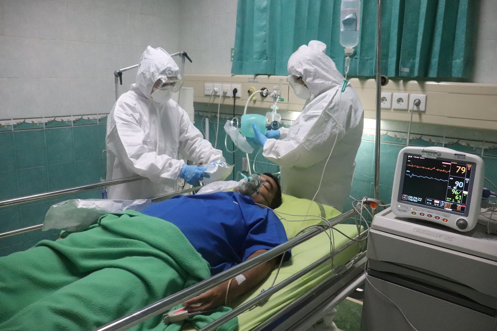

Nowadays, there are an increasing number of accidents and injuries that take place in Dhaka, the most prominent city in Bangladesh. This is because of the rapid development the country has been going through over the past few years. In such a scenario, it becomes essential for ambulances to be available 24/7 to serve people who are injured or have a medical emergency. One such [ambulance service](/) that meets this need is ICU Ambulance. In this blog post, we will explore the importance and necessity of ICU ambulances in Dhaka and why you should use them if you find yourself in a difficult situation.

## Definition of ICU Ambulance

ICU ambulances are an important part of the medical team that is available to stabilize patients who have suffered a stroke, heart attack, or other serious medical conditions. These ambulances are equipped with the necessary equipment and medications to help stabilize and treat those who are in critical condition.  
  
There is a high demand for ICU ambulances in areas like Dhaka, Bangladesh, where there is a large population that suffers from chronic diseases and health problems. In addition, Dhaka is one of the most populous cities in the world, which means that there is a high number of people who need immediate care after experiencing a health issue.  
  
ICU ambulances can provide lifesaving care to those who are in serious danger due to their illness or injury. They can also transport patients to nearby hospitals if they need additional treatment.

## Reasons for the Importance & Necessity of ICU Ambulance in Dhaka

The importance and necessity of an [ICU ambulance service in Dhaka](/icu-ambulance-service-dhaka/) cannot be overemphasized. Patients in the intensive care unit (ICU) are at high risk for serious health problems and often require intensive medical care. If a patient is not receiving quality care in the ICU, their chances of surviving may be significantly reduced.  
  
ICUs are typically staffed by highly experienced doctors and nurses who are able to provide good medical treatment to patients. This type of care is especially important for patients with serious health conditions, such as heart disease, kidney failure, or pneumonia. However, if a patient does not have access to an ICU ambulance service, they may end up having to wait long periods of time for treatment. This can lead to increased risks for complications and even death.  
  
ICUs are located throughout Dhaka city and the surrounding areas. If you or someone you know is experiencing a health emergency, it is important to seek help from an ICU ambulance service as soon as possible.

## Benefits of an ICU Ambulance

The importance and necessity of ICU ambulance in Dhaka cannot be overemphasized. The city is home to a high population density and an expansive metropolitan area, which means that there is a high probability of cardiac arrest occurring in any given day. If left untreated, cardiac arrest can lead to death.  
  
An ICU ambulance can provide critical care to patients who are experiencing cardiac arrest. By providing advanced life-saving measures such as CPR and defibrillation, an ICU ambulance can help to save lives. Additionally, an ICU ambulance can transport patients to nearby hospitals for further treatment.

### Timely and Appropriate Response

The ICU ambulance is an essential piece of equipment in any hospital. It ensures that patients are transported to the nearest hospital with the necessary medical supplies and personnel. In some cases, the ICU ambulance can mean the difference between life and death.  
  
In recent years, there has been a worrying increase in cases of [tuberculosis (TB) in Dhaka](https://www.gov.uk/government/publications/tuberculosis-test-for-a-uk-visa-clinics-in-bangladesh/tuberculosis-testing-in-bangladesh). This is a particularly dangerous form of TB and can be fatal if left untreated. As a result, it is vitally important that hospitals have access to an ICU ambulance to transport patients with TB quickly and safely to the nearest hospital with specialist resources available for treatment.  
  
Fortunately, many hospitals in Dhaka have access to an ICU ambulance. However, this service is not always available when patients need it most. For example, there have been reports of ambulances being unavailable when patients with TB are brought into hospitals in the early stages of their disease. This means that they may not receive the treatment they need and may die as a result.  
  
Hospitals must ensure that they have sufficient resources available to deal with emergency cases such as this one. If an ICU ambulance is not available when it is needed, patients may die as a result.

### High-Quality Medical Care

ICU ambulances are very important in Dhaka as the city has a high rate of critically ill patients. ICUs are equipped with the latest medical technologies and equipment and provide high-quality care to their patients.  
  
Most critically ill patients who arrive at an ICU in Dhaka are either suffering from heart or lung related diseases. This is because these diseases are particularly prevalent in Dhaka due to the high levels of air pollution in the city. The availability of ICU ambulances allows doctors to immediately transfer these patients to a specialist hospital if necessary.  
  
The ambulance service also allows doctors to quickly transfer other types of critically ill patients, such as those with stroke or brain injuries, to a specialized hospital. As a result, the quality of care received by these patients is always highest possible.

### Trained Medical Professionals

ICU ambulance service is very important for the people of Dhaka. It is a life-saving service that can help keep people in critical condition alive and out of the hospital. The ICU ambulance service is also a vital part of the overall healthcare system in Bangladesh, as it can quickly transport patients to the right hospitals around the city.

## Challenges in Achieving Quality Care

Quality healthcare is essential for a healthy population, and yet it remains one of the most challenging goals to achieve. This is due in part to the variability and complexity of diseases, as well as the ever-changing demands made on health systems. In order to provide quality care, hospitals and other health facilities need to have accurate information about patients’ conditions.  
  
This is where ICU ambulance services come in. By providing timely transport for critically ill patients, ICU ambulance services help ensure that patients receive the right care. In addition, providing this type of access can reduce overall congestion at hospitals, which can improve patient safety.  
  
Fortunately, there are many initiatives being undertaken to improve quality care in Dhaka. For example, the government is working to create a better understanding of critical illness among hospital staff by developing educational programs. Additionally, the Bangladesh [Red Crescent Society (BRCS)](https://bdrcs.org/) has been working to develop an online patient registry that will allow hospitals to track vital health data.  
  
Ultimately, it will require concerted effort from all stakeholders – including government officials, hospital staff, and private sector organisations – in order to achieve high quality healthcare in Dhaka. However, with efforts like these underway, it seems likely that quality care will become increasingly achievable over time

### Lack of Proper Resources

The lack of proper resources in the ICU sector is a pressing matter in Bangladesh. According to a report by the World Health Organization, only 30% of patients in ICUs receive the necessary care they require, and this figure is even lower in rural areas. This lack of access to ICUs can be attributed to a number of factors, including a shortage of health professionals and facilities, as well as a reluctance by patients and their families to seek treatment in an unfamiliar setting.  
  
One way that Dhaka is trying to address the issue of inadequate resources in the ICU sector is by partnering with hospitals overseas. In 2013, Dhaka signed an agreement with Singapore’s Mount Elizabeth Hospital to establish an international center for emergency medical services (EMS) in Dhaka. The agreement calls for Mount Elizabeth Hospital to provide training and mentorship to Bangladeshi medical professionals, as well as provide EMS services at no cost to the government.  
  
This arrangement not only provides access to better-quality care for patients in Dhaka, but it also sends a strong message about Bangladesh’s commitment to improving its healthcare system. By working together with other countries that have experience in providing quality EMS services, Dhaka can improve the availability and quality of care for its citizens.

### Limited Availability of Skilled Personnel

ICU ambulances are critically important in Dhaka as the city has a large population and a shortage of skilled personnel, which can lead to delays in treatment. ICUs have high-quality care that is unavailable in other areas of hospitals.  
  
There are only a few ICU ambulances in Bangladesh, and one has been out of service for months due to lack of resources. This leaves Dhaka residents with few options for emergency care if they fall ill or suffer a serious injury.  
  
ICUs are staffed by highly skilled professionals who can provide life-saving care if someone is feeling critically ill. Delays in receiving treatment can lead to serious health complications, including death.

### High Cost of Equipment

The high cost of equipment is a major challenge for hospitals in Bangladesh. In order to remain competitive, hospitals have to invest in the latest and most advanced medical technology. However, this costly investment can often not be justified when compared to other health care needs such as prevention or treatment of common diseases.  
  
Nonetheless, the high cost of equipment is an issue that hospitals in Bangladesh are working hard to address. One way that hospitals are trying to reduce the cost of equipment is by sharing resources and collaborating with each other. For example, two hospitals may jointly purchase a hospital Mac which can then be shared by both institutions.  
  
Another approach that hospitals are taking is to refurbish or reuse existing equipment. This can involve either repairing or upgrading old equipment so that it can continue to function properly. In some cases, refurbished or upgraded equipment may even be more affordable than new equipment.  
  
Overall, there are many ways that hospitals in Bangladesh are trying to reduce the cost of equipment. By doing so, they hope to improve patient care and make their facilities more affordable for taxpayers

## Conclusion

As the world’s largest metropolis and one of the most densely populated cities, Dhaka is always in need of an efficient emergency medical service. The ICU ambulance is a crucial part of this service and plays a vital role in ensuring that the city’s population receives the right care when it matters most.
