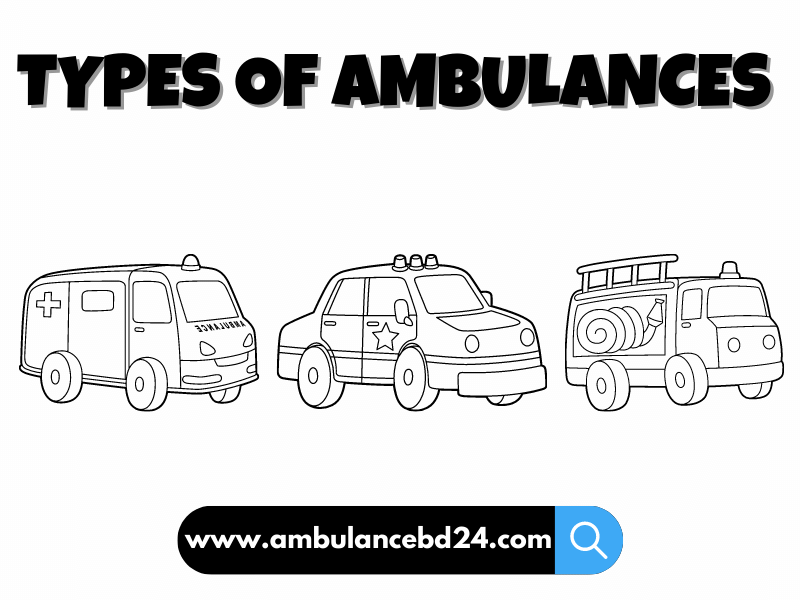

## Types Of Ambulances In Bangladesh

Ambulances are the most common and important vehicles used to transport patients. There are different types of ambulances that serve different emergency needs in Bangladesh.

### Basic Life Support (BLS) ambulance Service

The [basic life support (BLS) ambulance](https://www.ambulanceoncall.com/basic-life-Support-ambulance-in-chennai.html) is the most common type used in Bangladesh. It is equipped with advanced life support (ALS) equipment and supplies. BLS ambulances are used to transport people who have suffered a medical emergency, such as heart attacks and strokes, or those who have been involved in an accident.

### Advanced Life Support (ALS) ambulance Service

An ALS ambulance is equipped with advanced medical equipment to provide [advanced life support](https://en.wikipedia.org/wiki/Advanced_life_support) to the patients. ALS ambulances are usually used in trauma cases, cardiac arrests, and other critical situations. Such ambulances are staffed by a paramedic.

### Ac Ambulance Service

Ac Ambulance is a type of ambulance used in many countries. It is known as a stretcher-carrying vehicle and has a single attendant. [Ac Ambulance service](/ac-ambulance-service/) are also known as basic ambulance service or one-person ambulances. Ac Ambulances carry patients on stretchers, which can be either wheeled or fixed depending on the preference of the country’s health system.

### Non-Ac Ambulance

A non-ac ambulance is a vehicle that can be used to transport patients to the hospital. It’s less expensive than an ac ambulance, but it may not be as comfortable for the patient. Non-ac ambulances are used in rural areas where air ambulances are not available or are too expensive for low-income patients.

### Freezing Ambulance Service

A [freezing ambulance](/freezer-ambulance-service/) is an ambulance that has been modified to keep the body of a deceased person at a low temperature, which can help preserve it. The main benefit of using such an ambulance is that it keeps the deceased’s body cool while it’s being transported to the hospital or morgue so that they don’t have to be stored in ice and water like it would be if you used an ordinary vehicle like a van or bus. You can check our Freezing Ambulance Service

Another advantage of using this type of medical transportation is that it makes transporting patients easier than ever before. By doing so, your staff will be able to focus on other tasks related to their jobs instead of having them worry about how difficult transporting all those bodies was every day!

While there aren’t many disadvantages linked to using this type of transportation service other than higher costs due to additional maintenance costs involved when compared against normal vehicles these days due to their advanced nature (such as refrigeration systems), some companies may find themselves unable to afford such luxuries when looking budgeting for equipment needed across entire network systems (especially since most operating within tight budget constraints already). This can lead them back down the road where people had no choice but to rely upon less expensive alternatives like vans without air conditioning units installed inside cabins; however, this downside only applies if someone doesn’t want to spend more money upfront in order save time later on down the line.”

### Air Ambulance Service

Air Ambulance is used to transport patients who are critically ill or in critical condition and need to be transported quickly.

The use of air ambulances is becoming more common in the medical industry. Air ambulances are used to transport patients who are critically ill or in critical condition and need to be transported quickly. Air ambulances have been in use for decades, but the technology has changed significantly over time.

Air ambulances are typically used when a patient needs to be transported long distances, like from one country to another or from an urban center to a rural area. This can be done because of the speed and range of air ambulances.

The Air Ambulance service is available at Dhaka, Chittagong, and Cox’s Bazar.

### ICU Ambulance Service

ICU ambulances are equipped with advanced life support equipment and are used to transport critically ill or injured patients. They are also called “PICU ambulances”, which stands for Pediatric Intensive Care Unit (hospital). They have special features like:

-   Special stretchers can accommodate larger patients and keep them in a stable position while they’re being transported.
-   Large oxygen tanks, enough to provide all the necessary oxygen for the patient throughout their journey.

## Mobile Intensive Care Unit (MICU) ambulance Service

Mobile Intensive Care Unit (MICU) ambulance is equipped with a nurse who can provide advanced life support (ALS) care. MICU ambulances are equipped with a ventilator, monitor, and other equipment to treat patients with respiratory distress.

### Rescue Vehicles

-   Rescue vehicles are used to transport patients involved in an accident or other emergency.
-   They are usually equipped with first aid kits and basic medical equipment.
-   They are usually staffed by a paramedic who has undergone formal training in advanced medical procedures, including the administration of drugs and use of life support equipment.
-   Rescue vehicles may also be equipped with additional tools that can be used to extricate people from difficult situations such as entrapment in collapsed buildings or under heavy machinery, as well as specialized tools for cutting through metal objects such as car doors or fences.

### There are different types of ambulances that serve different emergency needs in Bangladesh

There are different types of ambulances that serve different emergency needs in Bangladesh. The basic life support (BLS) ambulance is the most common type of ambulance in Bangladesh. It is equipped with a defibrillator, oxygen cylinder, and drips. The advanced life support (ALS) ambulance has all the equipment that the BLS ambulance has but also carries intubation kits and other equipment needed for more complicated medical emergencies.

Ambulances that provide care to patients who have suffered cardiac arrest are known as Ac Ambulances because they have automatic external defibrillators (AEDs). Non-Ac Ambulances do not have AEDs on board; instead, they require a paramedic or physician to administer CPR before delivering a shock from an AED if one is available at their destination hospital.

### Conclusion

We hope you have gained a better knowledge of the different types of ambulances in Bangladesh. If you are looking for an ambulance service provider, please visit our website at [www.ambulancebd24.com](/)
