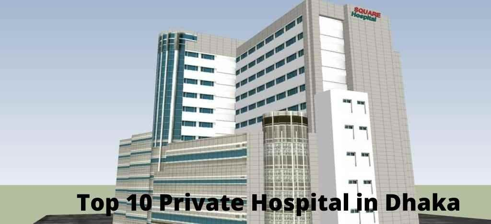
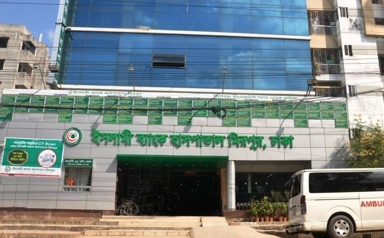

Medical science has improved with time. Many private hospitals have been founded in Dhaka. 10 well-known private hospitals in Dhaka have been discussed as per their quality of healthcare services.

## **Square Hospital**

Located in Dhaka’s core area, [Square Hospital Dhaka](/square-hospital-dhaka/) offers a wide range of medical services. It offers extra facilities to patients. It has three beautifully decorated multi-story buildings and a 500-bed treatment center. Due to its low cost and up-to-date equipment, this hospital comes first in this list of **top 10 private hospitals in Dhaka**, **Bangladesh**. The doctors and technicians at this hospital are both from around the world and from Bangladesh. In addition, the latest medical equipment is always on hand.

-    **Email:   info@squarehospital.com**
-   **Phone:10616**
-   **Address:18/F, Bir UttamQazi Nuruzzaman Sarak, West Panthapath, Dhaka 1205**

## **Evercare Hospital Dhaka**:

Apollo Hospital was the previous name of this institution. The hospital changed its name to Evercare Hospital Dhaka in 2020. It is situated in Dhaka’s Bashundhara territorial dominion. There are 450 beds at this hospital, and the doctors and nurses who work there are well-trained.

-   **Phone:****10678**
-   **see the hospital's official website**
-   **see the hospital's official website**

## **United Hospital Limited**

There are 500 beds available in this hospital, which is multidisciplinary. Furthermore, they provide people with a comprehensive healthcare solution that is available at a single location. This hospital is well known across the country. Cardiology, orthopedics, and cardiac surgery are currently available at the hospital. It also has a department for Gynaecology, as well as Neonatology and Pediatrics.

**see the hospital's official website**

**Appointment Hotline:see the hospital's official website**

**Emergency:10666**

## **LABAID Specialised Hospital**

This hospital specializes in cardiology. LAB AID Specialized Hospital in Bangladesh has created a new standard of care for cardiac patients. The LAB AID Specialized Hospital offers both inpatient and outpatient services. Moreover, there are 250 inpatient beds available. It also provides Lithotripsy Radiology and MRI facilities that make it one of the **top 10 private hospitals in Dhaka**.

<table><tbody><tr><td><strong>Address:</strong></td><td>House- 06, Road-04, Dhanmondi Dhaka-1205, Bangladesh</td></tr><tr><td><strong>Phone:</strong></td><td>see the hospital's official websitesee the hospital's official website</td></tr><tr><td><strong>Fax:</strong></td><td>see the hospital's official website</td></tr><tr><td><strong>Email:</strong></td><td>info@labaidgroup.com</td></tr><tr><td><strong>Mobile:</strong></td><td>see the hospital's official website-hour Open)</td></tr><tr><td><strong>Customer Care:</strong></td><td>see the hospital's official website&nbsp;&nbsp;</td></tr><tr><td><strong>Website:</strong></td><td><a href="http://labaidgroup.com/specialized">www.labaidhospital.com</a></td></tr></tbody></table>

## **Green Life Medical College Hospital**

Green Life Medical College is a non-government hospital in Dhaka. In 2005, they sought to open the door to private-sector speciality care. It eventually became a huge success. After that, in 2009, a group of doctors agreed to establish a medical school. This highly profitable private hospital is furnished with suitable in-patient facilities and the latest medical technology.

### Green Life Medical Postal Address

Green Life Medical College, MAK Khan Tower.31 and 31/1, Bir Uttam K.M. Shafiullah Sarak (Green Road), Dhaka – 1205, Bangladesh

### All Enquiries

see the hospital's official website

Email: [contact@greenlife.edu.bd](http://www.greenlife.edu.bd/page/contact)Email: [greenlife.mc@gmail.com](https://www.gmail.com/)

## **Anwer Khan Modern Hospital**

It’s a 750-bed hospital run by Modern Group and equipped with the latest medical technology and equipment. There are around 200 renowned doctors, medical experience, healthcare equipment, and modern administration at the hospital.

### Address

-   **AKMMC Hospital**
-   **Address:** House #17, Road #08, Dhanmondi, Dhaka-1205

#### Email

-   **info@akmmch.com**

#### Telephones

-   **Ph:** see the hospital's official website  
    see the hospital's official website
-   **Fax:** see the hospital's official website

## **Metropolitan Medical Centre**

MMCL’s distinguishing feature is the ability to cater to each patient’s individual needs. You can anticipate top-notch care when you visit this hospital. You’ll receive outstanding care from board-certified physicians and compassionate clinical staff

#### CONTACT INFO & DETAILS

You are most welcome to MMCL for your health services!

**Working hours \[ For Patients \]:** 24 Hours, 365 days

**Working hours \[ General \]:**  09 to 17 Hours, Except Holidays

**Phone : see the hospital's official website/ see the hospital's official website**

**Email: mmcl.nc78@gmail.com**

**46, Shaheed Taj Uddin Ahmed Sarani, Mohakhali, Dhaka.**  
**\[ Near Tangail Bus Stand\]**

.

## **Bangladesh Institute of Research and Rehabilitation For Diabetes, Endocrine and Metabolic Disorders (BIRDEM)**

BIRDEM has 600 beds and is situated in Shahbag, Dhaka. From the beginning, it was intended that BIRDEM will provide academic and research resources for the Bangladesh Diabetic Association. BIRDEM, on the other hand, begins offering services for diabetics. BIRDEM regularly treats 700 indoor patients and 3000 outdoor clients.

**Contact:**

<table><tbody><tr><td><strong>Dr.Nazimul Islam, MBBS, MPH</strong> Joint Director, Division of Hospital Services</td></tr></tbody></table>

**Hot Line:**

<table><tbody><tr><td><strong>24×7 HelpLine :</strong></td><td>PABX (BIRDEM): see the hospital's official website to 24 PABX (BIRDEM-2): 41050710 to 7</td></tr><tr><td><strong>24×7 Emergency :</strong></td><td>PABX :see the hospital's official website to 80, Ext-2302 Hotline:&nbsp;</td></tr><tr><td><strong>24×7 ICU Hotline :</strong></td><td>Mobile:&nbsp; Telephone: see the hospital's official website</td></tr><tr><td><strong>Ambulance Info :</strong></td><td>PABX : see the hospital's official website to 24, Ext-2302 Hotline:&nbsp;</td></tr><tr><td><strong>Information Desk :</strong></td><td>PABX: see the hospital's official website to 24, Ext:2313 Availability: From 7.30 am-8.00 pm</td></tr><tr><td><strong>Doctors Evening Chamber :</strong></td><td>PABX: see the hospital's official website Ext-2576,2575, Direct: see the hospital's official website</td></tr></tbody></table>

## **Ibrahim Cardiac Hospital & Research Institute**

This is another top private hospital in Dhaka. This hospital is renowned for its famous Anesthesiologist, Cardiologist, General Physician, Radiologist, and Vascular Surgeon.

<table><tbody><tr><td><strong>Contact</strong></td></tr><tr><td></td></tr><tr><td> <strong>HOTLINE – 10677</strong></td></tr><tr><td>&nbsp;PABX:see the hospital's official website&nbsp;Fax:see the hospital's official website&nbsp;&nbsp;</td></tr><tr><td>Inquiry/ Appointment – Ext: 206, 207 Mobile: see the hospital's official website</td></tr><tr><td>Cardiac Emergency – Ext:111, HOTLINE: see the hospital's official website</td></tr><tr><td>Cardiac Ambulance – Ext: 206, HOTLINE: see the hospital's official website</td></tr><tr><td>Diagnostic Laboratory – Ext: 215, 216, 217</td></tr><tr><td>Blood Bank – Ext: 264&nbsp;</td></tr><tr><td>Radiology &amp; Imaging – Ext: 136</td></tr><tr><td>VCT – Ext: 185</td></tr><tr><td>Cardiac Rehabilitation – Ext:140</td></tr></tbody></table>

## **Islami Bank Hospital**

Image from Google

Gastroenterologists and Hepatologists of this hospital have national as well as international qualifications, training, and experience. They ensure that patients are treated specially and uniquely.

##### Our Contacts

Head Office: Al-Razi Complex(10th & 11th Floor) 166, Shaheed Syed Nazrul Islam Sarani Purana Paltan, Dhaka 1000, Bangladesh Phone:see the hospital's official website Fax:7110505 Email: info@ibfbd.org Skype: ibfbd

## Conclusion :

Here is the Short list with contact details of well-known private hospitals in Dhaka. If you want their services then can contact them. Besides this, If you need any kind of Ambulance service then **[Ambulance BD](/) 24** will **help you**.
