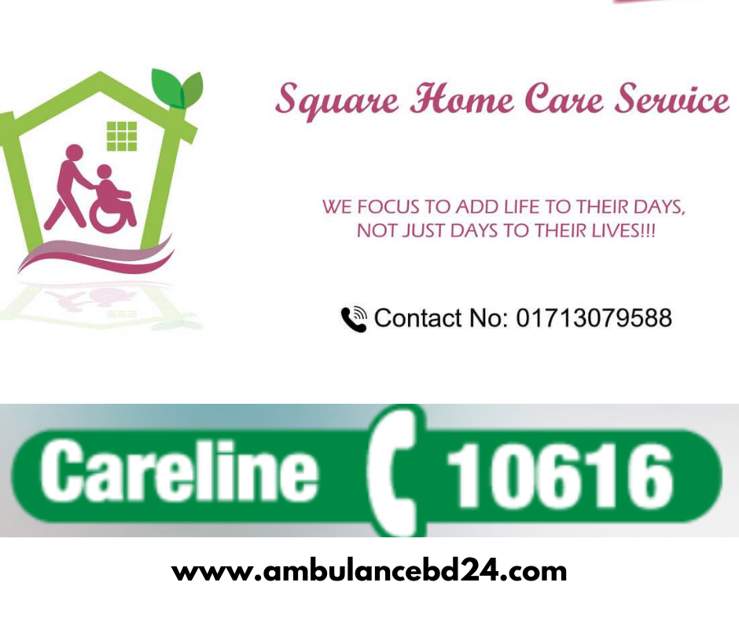
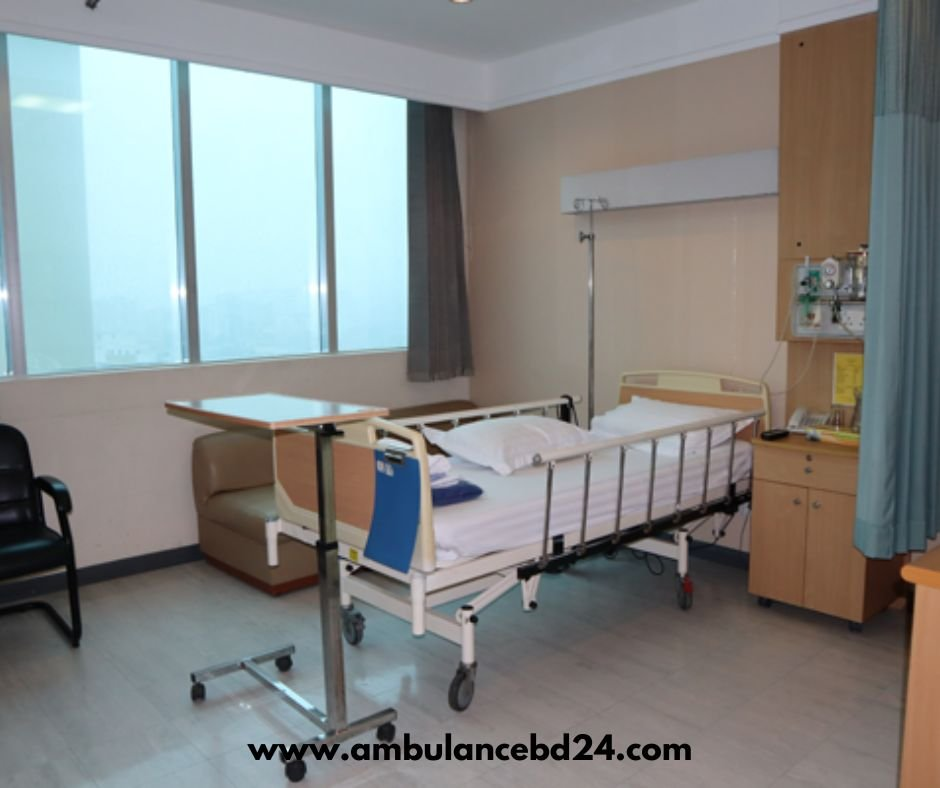

## All About Square Hospital

The **square hospital Dhaka** is regarded as one of Dhaka’s [top ten private hospitals](/private-hospitals-in-dhaka/). The square hospital provides the highest quality healthcare and clinical services, as well as exceptional personal attention. People can acquire the greatest treatment plan, even if it is expensive. Since its beginning on December 16, 2006, it has been focused on improving people’s health through the highest level of care. Square Hospital is a unit of Square Group, the country’s largest corporate conglomerate.

Square Hospital’s reputation is built on high-quality clinical outcomes and patient experience, which are made possible by world-class integrated healthcare facilities staffed by highly qualified experts. As a result, Square Hospitals seeks to satisfy patients’ expectations by providing high-quality treatment and making a positive difference in the healthcare system of Bangladesh.

### **Square Hospital Address**

Square Hospital has branches all over Bangladesh including Dhaka, Banani, Uttara, Mirpur, Sylhet. The address of the Dhaka branch is 18/F, Bir Uttam, Qazi Nuruzzaman Sarak, West Panthapath, Dhaka- 1205. Moreover, the address of the Sylhet branch is 156, Kajalshah, MAJ Osmani Medical College Road, Sylhet. 

### **Square Hospital Dhaka Hotline**

The hotline can be described as a point-to-point communication link that will help you connect with the desired destination in one go. The hotline of Square Hospital helps you connect directly without any additional action. The **Square Hospital Hotline** number is 10616. You can easily connect with any branch of the Square Hospital anytime you want. It is just one call away and can help you in any emergency situation.

### **Square Hospital Phone Number**

As Square Hospital has several branches all over Bangladesh, there are various phone numbers that will help you contact the hospital in an emergency situation. In case you are seeking to communicate with the hospital, you can dial the **square hospital contact number** Dhaka of the respective branches. It is the easiest way to reach the hospital as Square Hospital provides 24/7 emergency services. 

Square Hospital Phone Number **see the hospital's official website** or **see the hospital's official website** for the Banani branch of Square Hospital. For the Uttara branch, you need to dial see the hospital's official website or **see the hospital's official website**. In the case of the Mirpur branch of Square Hospital, the phone numbers are **see the hospital's official website** and **see the hospital's official website.** You need to dial see the hospital's official website and see the hospital's official website to contact the Sylhet branch of this hospital.

### **Square Hospital Dhaka Support Services**

[Square Hospital](http://www.squarehospital.com/) is one of the well-known private hospitals in Bangladesh. It has several branches that provide quality healthcare services. It has more than 3000 highly qualified medical professionals who deliver the required treatment and support to the patients. Moreover, Square Hospital has 110 consultation rooms and 500 beds for in-house patients. 

The square hospital has maintained a standard of housekeeping and cleaning services that are exceptional in Bangladesh. There are waiting rooms in every branch of Square hospital. Moreover, this hospital has a dedicated prayer room where family members of patients can pray for a speedy recovery.    

All the branches of this hospital maintain USA standard security systems. Cafeteria, roof-top garden along with free wifi is available in Square Hospital. A car parking facility is also available in all the branches of Square Hospital.

### Square Hospital dhaka Emergency Service :

Square Hospital Emergency Room (ER) offers non-stop life-saving treatment whenever needed all day all week long. ER offers all vital medical support for critically ill patients, including the use of ventilators as well as defibrillators. The nurses and doctors are specifically trained to manage any emergency patient.

 Square Hospital ER has fully equipped, top-of-the-line Mercedes Benz [ambulance services](/tips-to-find-ambulance-service/) with specially trained personnel. We also offer the exclusive Square [Air Ambulance service](/air-ambulance-service-bangladesh/), featuring a brand-new Bell 407 helicopter, loaded with life-saving equipment for transporting patients from any location in the United States. Patients receive fully integrated emergency medical care in the Square Hospital Emergency Room. In that case, Square Hospital is very active in emergency service. You can check the [**ambulance service in Dhaka**](/) by Ambulance BD 24 for emergency services.

### **Square Hospital Dhaka Doctor List**

Square Hospital is famous for its high-quality medical care that has been possible for well-trained and experienced doctors. The following doctor list contains the **top 10 doctors of Square hospital**. Here is the square hospital doctor list:

1.  **Dr. A.B.M Sarwar-E-Alam**

-   Qualification: MBBS, FCPS
-   Designation: Consultant
-   Expertise: Internal Medicine

2.  **Dr. Abdul Kader Shaikh**

-   Qualification: FCPS, MD
-   Designation: Assistant Professor
-   Expertise: Neuromedicine

3.  **Dr. Abdullah Al Jamil**

-   Qualification: MBBS, FCPS, MD, FCAPSC, Trained in EPS & RFA (AIIMS, India)
-   Designation: Consultant
-   Expertise: Cardiology

4.  **Dr. Ahmed Zahid Hossain**

-   Qualification: MBBS, MS ( Ped. Surgery )
-   Designation: Associate Consultant
-   Expertise: Pediatric Surgeon

5.  **Professor Dr. Anaware Begum**

-   Qualification: MBBS, FCPS ( Gyne & Obs )
-   Designation: Consultant
-   Expertise: Gynecology & Obstetrics

6.  **Dr. ATM Samdani**

-   Qualification: MBBS, MD ( Radiology and Imaging from BIRDEM )
-   Designation: Associate Consultant
-   Expertise: Urology

7.  **Dr. Kazi Ali Hassan**

-   Qualification: MBBS, M.Phil (EM), MRCP (UK)
-   Designation: Consultant, Specialist of Endocrinologist
-   Expertise: Diabetes & Endocrine

8.  Professor Dr. **Md. Khalilur Rahman**

-   Qualification: MBBS, MCPS, FCPS, DA (UK), FFARCS (Ireland)
-   Designation: Consultant
-   Expertise: Anesthesiology

9.  **Dr. Khandaker Abu Talha**

-   Qualification: MBBS, MCPS, MS
-   Designation: Consultant
-   Expertise: Neurosurgeon

10.  **Dr. M. Motahar Hossain**

-   Qualification: FCPS ( Medicine), MD ( Hepatology )
-   Designation: Consultant – Gastroenterology & Hepatology
-   Expertise: Gastroenterology

### **Square Hospital Dhaka Appointment**

This hospital offers both in-house patient care facilities along outdoor care services. Famous doctors practice and conduct their chambers from Square Hospitals. Therefore, it is very difficult to get an immediate consultancy. In the case of an emergency, you can opt for a special appointment. 

You need to make an appointment by calling the hotline number 10616. Otherwise, you can call the respective numbers of the branches for getting any required information regarding the doctors. Moreover, you can make an appointment with doctors by calling the phone numbers.

### **Square Hospital Dhaka Price List**

As Square Hospital is the topmost private hospital in Bangladesh, the treatment is quite expensive here. However, the hospital is known for its healthcare service. Moreover, the staff of this hospital looks after the personal requirements of each patient. 

The following **square hospital price list** will disclose the approximate charges of the respective packages.

<table><tbody><tr><td><strong>Name Of Package</strong></td><td><strong>Twin Shared&nbsp;</strong></td><td><strong>Single Deluxe&nbsp;</strong></td><td><strong>Suite&nbsp;</strong></td><td><strong>Duration of stay</strong></td></tr><tr><td>Cesarean Delivery Package</td><td>110,500</td><td>140,500</td><td>227,500</td><td>4 Days</td></tr><tr><td>Abdominal Hysterectomy Package (With or without BSO)</td><td>108,500</td><td>129,500</td><td>215,500</td><td>4 Days</td></tr><tr><td>Abdominal Hysterectomy Package (With or without BSO) – High Risk</td><td>119,500</td><td>142,500</td><td>226,500</td><td>4 Days</td></tr><tr><td>Myomectomy (Abdominal) Package</td><td>108,500</td><td>129,500</td><td>215,500</td><td>4 Days</td></tr><tr><td>Laparotomy Package</td><td>79,500</td><td>101,500</td><td>164,500</td><td>3 Days</td></tr><tr><td>Complicated Laparotomy</td><td>92,500</td><td>120,500</td><td>205,500</td><td>4 Days</td></tr><tr><td>Dilatation and Curettage(IPD )</td><td>32,500</td><td>40,500</td><td>61,500</td><td>1 Day</td></tr><tr><td>Normal Delivery Package</td><td>59,500</td><td>69,000</td><td>90,500</td><td>1 Day</td></tr><tr><td>Diagnostic Dilatation and Curettage With Cervical Biopsy (Day Care )</td><td>35,500</td><td></td><td></td><td>Bed for 12 hours</td></tr><tr><td>LAVH Package</td><td>111,500</td><td>138,500</td><td>224,500</td><td>4 Day</td></tr></tbody></table>
