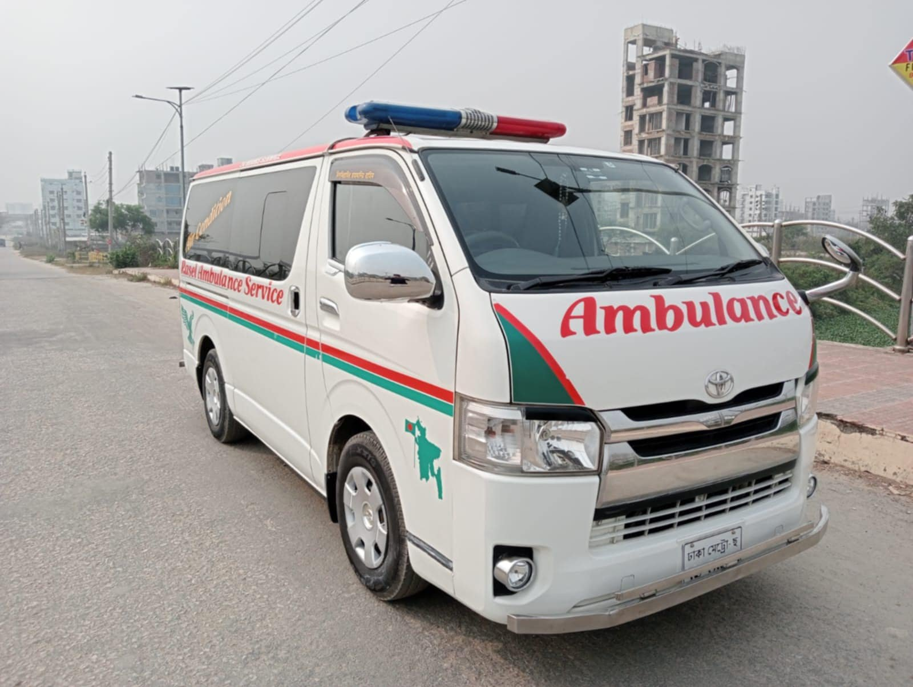

Hey there! Have you ever found yourself in a situation where you or a loved one suddenly needed urgent medical attention? It’s a scary thought, right? In those moments of panic, one of the first things that often comes to mind is, “[Do we need an ambulance](/)?” And then, a whole new set of questions pops up: “Will they take us?” “Is it really necessary?” “Will it be covered?”

Here in Bangladesh, knowing when an ambulance ride is considered a “medical necessity” can feel a bit like navigating a maze. But don’t worry, you’re not alone! This guide is here to clear up all that confusion, making sure you feel confident and informed about when to call for help. We’ll break down what medical necessity truly means for ambulance transport, so you can make good decisions for your family when it matters most. Let’s dive in!

### Key Takeaways

-   **Medical Necessity is Key:** An ambulance ride is typically considered medically necessary when your condition is serious enough that you can’t be safely transported by any other means, and you need immediate medical care during the journey.
-   **Life-Threatening Situations:** Always call an ambulance for emergencies like severe chest pain, difficulty breathing, major injuries, or loss of consciousness. These are clear medical necessities.
-   **Professional Judgment Matters:** [Ambulance crews](/icu-ambulance-service-dhaka/) and doctors play a crucial role in determining medical necessity based on your symptoms and condition at the time of transport.
-   **Documentation is Your Friend:** Good medical records from the scene and hospital help prove the necessity of the ambulance trip.
-   **Know Your Insurance:** Understand what your health insurance or public health schemes cover for emergency medical transport in Bangladesh.

## Understanding Medical Necessity: More Than Just a Ride

So, what exactly does “medical necessity” mean when we’re talking about an ambulance? It’s not just about feeling unwell; it’s about whether your health condition is so serious that you absolutely *need* immediate skilled medical care during transport, or if moving you in a regular car would put your health at significant risk. Think of it this way: an ambulance isn’t just a fast taxi to the hospital; it’s a mobile emergency room with trained professionals ready to provide life-saving care on the go.

### What Makes an Ambulance Ride “Necessary”?

Imagine you’re suddenly feeling a sharp, crushing pain in your chest. Or perhaps someone you’re with has had a serious accident and is bleeding heavily. In these moments, every second counts. Here’s what usually qualifies an ambulance ride as a medical necessity:

-   **Severity of Condition:** Your illness or injury is severe and potentially life-threatening. This means you need immediate medical attention that can’t wait.
-   **Need for Skilled Medical Care During Transport:** You may require oxygen, IV fluids, medication, or continuous monitoring by paramedics or emergency medical technicians (EMTs) during transportation.
-   **Risk of Harm Without Ambulance:** Transporting you by any other means (like a private car or taxi) would endanger your health, worsen your condition, or even be impossible due to your state. For example, if you’re unconscious or have a suspected spinal injury, moving you without proper equipment and trained personnel could cause more harm.
-   **Lack of Alternative Safe Transport:** There’s no other safe and appropriate way to get you to the nearest medical facility that can adequately treat your condition.

Let’s look at some scenarios where an ambulance is almost always considered medically necessary.

### When to Definitely Call an Ambulance: Clear Medical Necessities

Sometimes, it’s crystal clear that an ambulance is the right call. These are situations where delaying professional medical help or attempting self-transport could have dire consequences.

#### Life-Threatening Emergencies

These are the big ones, where immediate, on-the-spot medical intervention can be the difference between life and death.

-   **Severe Chest Pain or Heart Attack Symptoms:** If you feel crushing chest pain, pain spreading to your arm or jaw, shortness of breath, sweating, or nausea, these could be signs of a heart attack. Paramedics can start treatment immediately, like administering aspirin or oxygen, and prepare you for advanced care at the hospital. Call [ICU ambulance in Dhaka](/icu-ambulance-service-dhaka/)
-   **Difficulty Breathing or Choking:** This includes severe asthma attacks, allergic reactions causing airway swelling, or choking that isn’t resolving. An ambulance crew can provide oxygen, administer bronchodilators, or perform procedures to clear an airway.
-   **Severe Allergic Reactions (Anaphylaxis):** If someone is having a severe allergic reaction with difficulty breathing, swelling, or a sudden drop in blood pressure, they need immediate adrenaline (epinephrine) and transport.
-   **Sudden Weakness or Numbness (Stroke Symptoms):** If you notice sudden weakness on one side of the body, difficulty speaking, facial drooping, or confusion, these are signs of a stroke. Time is crucial for stroke treatment, and paramedics can alert the hospital to prepare.
-   **Unconsciousness or Altered Mental State:** If someone passes out and doesn’t quickly regain consciousness, or becomes severely confused and disoriented, they need urgent medical evaluation.
-   **Major Trauma or Accidents:** This covers serious injuries from road accidents, falls from heights, gunshot wounds, or severe burns. These often involve internal injuries, fractures, or significant bleeding that require immediate stabilization and specialized transport. For areas like [Rajshahi](/inter-district-ambulance-service/), quick response is critical
-   **Severe Bleeding that Won’t Stop:** If a wound is bleeding profusely and you can’t control it with direct pressure, paramedics can apply advanced dressings, tourniquets, or start IV fluids.
-   **Severe Head Injuries:** Any significant blow to the head, especially if followed by loss of consciousness, confusion, vomiting, or seizures, warrants immediate [ambulance](/) transport.
-   **Seizures (Especially First-Time or Prolonged):** If someone has a seizure for the first time, or a seizure that lasts a long time, or multiple seizures without regaining consciousness, they need urgent medical attention.
-   **Poisoning or Overdose:** If someone has ingested a poisonous substance or taken an overdose of medication, they need immediate medical intervention. Paramedics can provide first aid and transport to a facility equipped for toxicology emergencies. [Ambulance in Khulna](/inter-district-ambulance-service/) can handle toxicological emergencies.

#### Conditions Requiring Specialized Care During Transit

Sometimes, it’s not just about getting there fast, but about getting there safely with medical support.

-   **Suspected Spinal Injuries:** If there’s any suspicion of a neck or back injury (e.g., after a fall or accident), paramedics use specialized equipment like backboards and neck collars to immobilize the patient and prevent further damage during transport.
-   **Severe Burns:** Extensive or deep burns require immediate pain management, fluid resuscitation, and sterile dressings, all of which can be initiated by paramedics.
-   **Childbirth Emergencies:** If labor is progressing rapidly, or there are complications like heavy bleeding or the baby presenting unusually, an ambulance provides a safe environment for delivery if necessary, and immediate care for mother and baby.
-   **Patients Requiring Oxygen Support:** Individuals who need continuous oxygen to breathe comfortably and safely, especially if their condition is worsening, will benefit from an ambulance with onboard oxygen supply. It is provided by [AC ambulance services](/ac-ambulance-service/).
-   **Patients on Life Support or with Complex Medical Equipment:** If someone is on a ventilator or other critical life-sustaining equipment, an [NICU ambulance in Dhaka](/nicu-ambulance-service-dhaka/) is essential. With appropriately trained personnel, they can safely transport them.

### When an Ambulance Might Not Be Medically Necessary (But Still Important)

It’s equally important to understand situations where an ambulance might **not** be considered medically necessary, even if you feel unwell. This doesn’t mean your discomfort isn’t valid, but rather that your condition might not require the immediate, specialized care provided during [ambulance transport](/ac-ambulance-service/).

For milder issues like a sprain or minor fever, self-transport may be fine. But for areas far from city centers, consider help from [Mirpur ambulance services](/ambulance-service-areas-dhaka/) if unsure.

**A Friendly Tip:** When in doubt, it’s always better to call and ask. Many ambulance services or emergency hotlines in Bangladesh can provide guidance over the phone. They’ll ask you a few questions about the patient’s condition and help you decide if an ambulance is needed.

## The Role of Medical Professionals in Determining Necessity

You might be thinking, “How do they *really* decide if it’s necessary?” It’s not just a random guess! Medical professionals, from the person answering your emergency call to the paramedics who arrive on the scene, use their training and expertise to make this crucial judgment.

### Dispatchers and Initial Assessment

When you call an emergency number, the dispatcher is your first point of contact. They are trained to ask specific questions about the patient’s symptoms, the nature of the emergency, and the immediate environment.

-   **Questioning Protocol:** They follow a structured set of questions (sometimes called “triage protocols”) to quickly assess the severity of the situation. They’ll ask about breathing, consciousness, pain levels, and any visible injuries.
-   **Prioritization:** Based on your answers, they categorize the call’s urgency. A “Code Red” call for a suspected heart attack will get an ambulance dispatched immediately, often with lights and sirens, while a less critical call might be responded to without urgency or even advised to seek alternative transport.
-   **Pre-Arrival Instructions:** For truly critical situations, they might even give you life-saving instructions over the phone, like how to perform CPR or control bleeding, until the ambulance arrives.

### Paramedics and On-Scene Evaluation

Once the ambulance arrives, the paramedics or EMTs take over. They are highly trained medical professionals who conduct a thorough assessment right there and then.

-   **Patient Assessment:** They’ll perform a quick but comprehensive evaluation of the patient’s vital signs (blood pressure, heart rate, breathing, oxygen levels), level of consciousness, and the nature of their symptoms or injuries.
-   **Clinical Judgment:** Based on their assessment, their medical knowledge, and established protocols, they make a clinical judgment about whether the patient requires immediate transport with medical care. They consider factors like:
    -   Is the patient stable or unstable?
    -   Are their vital signs deteriorating?
    -   Do they require interventions (e.g., oxygen, IV fluids, medication) *during* transport?
    -   Is there a risk of their condition worsening significantly if not transported immediately or by alternative means?
    -   Can they be safely moved without specialized equipment?
-   **Decision to Transport:** If they determine that the patient’s condition meets the criteria for medical necessity, they will prepare the patient for transport to the nearest appropriate medical facility. If, after assessment, they find the situation is not an emergency (e.g., a minor injury that can be self-managed or taken to a clinic by family), they might advise against ambulance transport.

### Hospital Staff and Documentation

Even after you arrive at the hospital, the concept of medical necessity continues to be important, especially for billing and insurance purposes.

-   **Emergency Room Assessment:** ER doctors and nurses further evaluate the patient’s condition and document their findings. This documentation often corroborates the paramedics’ initial assessment and justifies the ambulance transport.
-   **Medical Records:** The patient’s medical records from the hospital, including the diagnosis and treatment provided, are crucial evidence. If a patient was admitted to the hospital or received significant emergency treatment, it generally supports the claim of medical necessity for the ambulance ride.

**Why is all this documentation important?** Because insurance companies or public health schemes often review these records to determine if they will cover the cost of the ambulance service. Without clear documentation of medical necessity, you might find yourself footing the bill.

## Financial Aspects: Who Pays for What in Bangladesh?

This is where things can get a bit tricky, and understanding the financial side of ambulance services in Bangladesh is super important. Unlike some countries with universal emergency services, the cost of ambulance transport here can vary widely.

### Public vs. Private Ambulance Services

In Bangladesh, you’ll generally find two main types of ambulance services:

-   **Government Hospitals/Services:** Many public hospitals (like Dhaka Medical College Hospital, Shaheed Suhrawardy Medical College Hospital, etc.) operate their own ambulance services. These are often more affordable, or sometimes even free for very critical cases, especially if you’re being transferred between government facilities. However, their availability can be limited, and arrival times might vary.
-   **Private Ambulance Services:** A large number of private ambulance companies operate across the country. These typically offer faster arrival times, more modern vehicles, and advanced equipment. However, they come with a higher cost.

### Factors Influencing Cost

The price of an ambulance ride can depend on several things:

-   **Distance:** The further the distance, the higher the cost.
-   **Type of Ambulance:**
    -   **Basic Life Support (BLS):** This is your standard ambulance with trained EMTs, oxygen, basic first aid, and stretcher. It’s for less critical but still transport-necessary cases.
    -   **Advanced Life Support (ALS):** These ambulances are equipped with more advanced medical equipment (like defibrillators, ECG machines, IV pumps) and staffed by paramedics who can administer medications, perform advanced airway procedures, and monitor vital signs continuously. They are used for serious, life-threatening emergencies and are more expensive.
    -   **AC vs. Non-AC:** Some private ambulances offer air-conditioned vehicles, which can add to the cost, especially for longer journeys.
-   **Medical Equipment/Services Used:** If the paramedics administer medications, use oxygen for an extended period, or perform complex procedures during transport, these might incur additional charges.
-   **Time of Day/Night:** Some services might charge a premium for late-night or early-morning calls.
-   **Urgency:** While not always a separate charge, the level of urgency (e.g., lights and sirens vs. standard transport) reflects the type of service provided, often an ALS service, which is inherently more costly.

### Insurance Coverage in Bangladesh

This is a big one. While health insurance is growing in Bangladesh, comprehensive coverage for emergency ambulance services isn’t always standard.

-   **Limited Coverage:** Many local health insurance policies might have limited or no specific coverage for ambulance transport unless it’s explicitly mentioned as part of a hospitalization benefit.
-   **Corporate Health Plans:** If you’re covered by a corporate health insurance plan provided by your employer, check the details carefully. Some of these plans offer better coverage for emergency medical services, including ambulance fees, especially if it leads to hospitalization.
-   **International Travel Insurance:** If you’re a foreigner or traveling with international travel insurance, emergency medical evacuation and ambulance services are often a key part of the policy, but they will still require proof of medical necessity.
-   **Self-Pay:** For many, especially those without comprehensive health insurance, the cost of an ambulance ride will be out-of-pocket. This is why understanding medical necessity is crucial – you want to ensure you’re paying for a service you truly need.

**Important Note:** Always clarify the cost and potential insurance coverage *before* calling a private ambulance service if the situation is not immediately life-threatening. For true emergencies, however, don’t hesitate. Life comes first.

### Understanding the “No Medical Necessity” Scenario

What happens if you call an ambulance, they arrive, assess you, and determine it’s *not* a medical emergency? This can happen. For example, if you call for a high fever, but when they arrive, your fever has gone down, and you appear stable and can walk.

-   **Assessment Fee:** Some private ambulance services might charge an assessment fee even if they don’t transport you.
-   **Advice for Alternative Transport:** They might advise you to take a taxi or private car to a local clinic or hospital for non-emergency evaluation.
-   **No Obligation to Transport:** They are generally not obligated to transport you if they deem it not medically necessary, especially if their resources are needed for true emergencies.

This emphasizes why it’s so important to accurately describe symptoms to the dispatcher and be prepared for the on-scene assessment.

## Common Misconceptions About Ambulance Use

There are quite a few myths and misunderstandings floating around about when and how to use an ambulance. Let’s clear some of them up!

### Myth 1: “An ambulance will get me seen faster at the hospital.”

**Reality:** While ambulances do bring you directly to the emergency department, they don’t necessarily mean you’ll jump the queue. Hospitals use a triage system, meaning patients are seen based on the severity of their condition, not just how they arrived. If you arrive by ambulance for a non-life-threatening issue, you might still wait behind someone who walked in with a more critical condition.

### Myth 2: “If I call an ambulance, I *have* to go to the hospital.”

**Reality:** Not necessarily. Paramedics will assess you on site. If they determine your condition is not life-threatening and can be managed at home or by a visit to a general practitioner, they might advise against transport. However, if they recommend transport due to medical necessity, it’s usually wise to follow their advice. You always have the right to refuse transport, but you might be asked to sign a waiver acknowledging the risks.

### Myth 3: “Ambulances are only for accidents.”

**Reality:** While accidents are a common reason for ambulance calls, ambulances are vital for a wide range of medical emergencies, including sudden illnesses like heart attacks, strokes, severe asthma attacks, diabetic emergencies, and allergic reactions. Any condition that requires immediate, skilled medical care during transport falls under their purview.

### Myth 4: “If I’m unconscious, my family can just take me in their car.”

**Reality:** Transporting an unconscious person in a regular car is highly risky and often impossible without specialized equipment. An unconscious person might have an airway obstruction, require oxygen, or need constant monitoring. Paramedics are trained to manage these situations safely. This is a prime example of medical necessity.

### Myth 5: “Calling an ambulance for anything less than a heart attack is wasting resources.”

**Reality:** While we want to ensure ambulances are available for the most critical cases, it’s also true that many serious conditions *start* with symptoms that might seem mild but quickly escalate. If you are genuinely concerned about a sudden, severe symptom (like severe pain, sudden weakness, or difficulty breathing), it’s always better to call. Let the trained professionals assess the situation. They’re there to help, not to judge.

## Preparing for an Ambulance Arrival: What You Can Do

If you find yourself in a situation where you’ve called an ambulance, a little preparation can make a big difference for the patient and the ambulance crew.

### Before They Arrive

-   **Ensure Clear Access:** If possible, unlock your gate or door. Clear any obstacles in the pathway to the patient. Turn on outside lights if it’s dark.
-   **Gather Important Information:**
    -   **Patient’s Medical History:** Any known conditions (diabetes, heart disease, [asthma](https://en.wikipedia.org/wiki/Asthma), etc.).
    -   **Current Medications:** A list of all medications the patient is taking, including dosage and frequency. If possible, gather the actual medicine bottles.
    -   **Allergies:** Any known drug or food allergies.
    -   **Contact Information:** Name and number of the patient’s primary doctor or nearest family member (if not present).
    -   **Recent Hospitalizations/Surgeries:** Details if applicable.
-   **Have ID Ready:** Keep the patient’s NID (National ID card) or other identification handy.
-   **Designate a Point Person:** If multiple people are present, choose one person to communicate with the ambulance crew to avoid confusion.
-   **Keep Pets Secured:** If you have pets, secure them in a separate room to prevent them from interfering with the paramedics.

### When They Arrive

-   **Direct Them Clearly:** Guide the paramedics to the patient’s location without delay.
-   **Provide Information Calmly:** Answer their questions clearly and concisely. Share the information you gathered earlier.
-   **Listen to Instructions:** Follow any instructions the paramedics give you.
-   **Don’t Obstruct Their Work:** Give them space to work and perform their assessment.
-   **Prepare a Small Bag (if possible):** If the patient is likely to be hospitalized, a small bag with essentials (toothbrush, a change of clothes, phone charger) can be helpful, but only if it doesn’t delay emergency care.

### What to Expect During Transport

-   **Continuous Monitoring:** Paramedics will constantly monitor the patient’s vital signs and condition.
-   **Medical Interventions:** They may administer oxygen, IV fluids, medications, or perform other procedures as needed to stabilize the patient.
-   **Communication:** They might communicate with the hospital ahead of time to give them a heads-up about the patient’s condition, allowing the hospital to prepare for their arrival.
-   **Your Role:** If you’re accompanying the patient, continue to provide support and ask any questions you have about their care.

Being prepared not only helps the medical team do their job more efficiently but also reduces stress during an already difficult time.

## Conclusion: Making Informed Choices for Your Health

Navigating medical emergencies can be daunting, especially when you’re trying to figure out if an ambulance is truly needed. We hope this guide has shed some light on what constitutes a “medical necessity” for ambulance transport here in Bangladesh. Remember, it’s about more than just getting to the hospital; it’s about needing immediate, skilled medical care during that journey, or facing significant risk if transported otherwise.

Knowing when to call, what to expect, and understanding the financial aspects can empower you to make informed decisions for yourself and your loved ones. Always prioritize safety and immediate medical attention in genuine emergencies. And when in doubt, it’s always better to call and let the professionals assess the situation. Your health, and the health of those you care about, is priceless.

Stay safe, stay informed, and take care of yourselves!

## Frequently Asked Questions (FAQs)

### Q1: Can I choose which hospital the ambulance takes me to?

**A1:** In an emergency, ambulances typically aim to take you to the nearest appropriate medical facility equipped to handle your condition. For example, if you’re having a heart attack, they’ll prioritize a hospital with a cardiac care unit. While you can express a preference, the paramedics’ primary goal is to ensure your safety and immediate access to the necessary care, which might mean the closest hospital.

### Q2: What if I call an ambulance and then feel better before they arrive?

**A2:** If your condition significantly improves and you no longer feel you need an ambulance, it’s important to call the emergency number back immediately to inform them. This allows them to divert the ambulance to another emergency if needed. When they arrive, they will still assess you to ensure you are indeed stable and don’t require transport. You might be asked to sign a refusal of transport form.

### Q3: Is it okay to use an ambulance for non-emergency transport, like going to a doctor’s appointment?

**A3:** Generally, no. Ambulances are primarily for emergency medical transport where a “medical necessity” exists. For routine appointments or non-urgent transfers between medical facilities, you would typically arrange for a non-emergency medical transport service (which might be a basic ambulance or a specialized medical taxi) or use private transport. Using an emergency ambulance for non-emergencies can use up vital resources that are needed for life-threatening situations.

### Q4: Will an ambulance service charge me if they come but don’t transport me?

**A4:** For [private ambulance services](/) in Bangladesh, it’s common for them to charge an assessment fee or a call-out fee even if no transport occurs, especially if they’ve travelled a significant distance. Government ambulance services might have different policies. It’s always a good idea to clarify this with the service when you call, if the situation allows for it.

### Q5: What information should I have ready when I call 999 for an ambulance in Bangladesh?

**A5:** When you call 999 (Bangladesh’s national emergency hotline), try to have the following information ready:

1.  **Your exact location:** Provide the full address, including landmarks if possible.
2.  **The nature of the emergency:** Clearly describe what happened or what the patient’s symptoms are.
3.  **The patient’s condition:** Are they conscious, breathing, bleeding, or in pain?
4.  **Your contact number:** In case they need to call you back.  
    Stay calm, speak clearly, and follow the dispatcher’s instructions.
