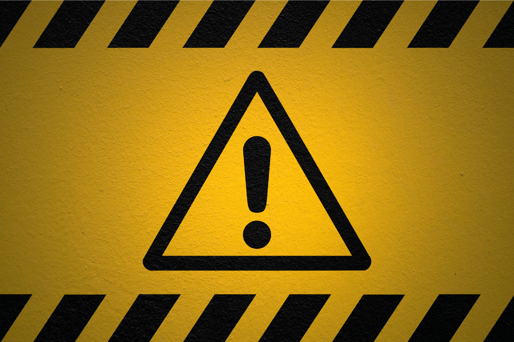

If you are feeling unwell, it is important to call an ambulance. Ambulances can provide medical help quickly and safely when needed, and can also be used for other purposes if the patient is able to receive treatment. Before calling an ambulance, be sure to know what you should do if you feel like you are in danger or have a [medical emergency](https://en.wikipedia.org/wiki/Medical_emergency).

## What to do In Case of Emergency

**If you’re ever in a situation where you need to call an ambulance, here are some things to keep in mind:**

1.  Always know the address of the emergency room or hospital where you are going.
2.  Have the ambulance’s route information ready so that you can give it to the dispatcher.
3.  Make sure that you have all of your personal information, including your insurance information, handy so that the ambulance crew can contact your insurance company if necessary.
4.  Make sure that you have any medical information about the person who is receiving treatment with you handy as well, such as their symptoms and medications they are taking.
5.  Inform the dispatcher if there are any allergies or special medical conditions that may complicate an emergency transport.
6.  If possible, have someone else drive your car to the hospital while you’re waiting for the ambulance to arrive.
7.  Prepare yourself for what may happen during transport: if something goes wrong, be prepared to answer questions and communicate with staff on behalf of your patient.

## How to stay Safe in Dangerous Situations

**If you find yourself in a dangerous situation, a good way to stay safe is to follow these tips:**

1.  **Stay calm**: If you’re panicking, it’s going to make things much worse.
2.  **Don’t try to fight or flee**: These actions will only make the situation more difficult and potentially dangerous for you and others around you.
3.  **Try to assess the situation before reacting:** If you don’t know what’s going on, your first instinct may be to do something that could put yourself or others in harm’s way.
4.  **Keep communication open with those around you:** Tell them what’s happening and ask for their help if needed. You may also want to keep a phone with [emergency ambulance number](/) in case of an emergency so they can reach you quickly.
5.  Know where help is available should something go wrong. If possible, notify authorities of your location and what kind of assistance you need (e.g., police, medical assistance).

## What is an Emergency?

In Bangladesh, an ambulance is typically summoned when there is a serious medical emergency. However, in some cases ambulances may be called for less serious emergencies. There are four types of ambulances: basic, advanced life support (ALS), rescue, and special operations. Basic ambulances provide care for patients who require only stabilization and masking of symptoms. Advanced life support ambulances are equipped to provide critical care including respiratory assistance and cardiac monitoring. Rescue ambulances are designed to transport patients who are fatally injured or who have major breathing problems. Special operations ambulances are specifically trained to respond to situations such as car crashes, shootings, and natural disasters.

## Examples of Emergencies

If you are experiencing a medical emergency, do not wait! Do not try to handle the situation yourself. Contact your local emergency number immediately. Here are some common medical emergencies and what to do if you experience them:

**Cardiac arrest:** If you experience chest pain, shortness of breath, or an irregular heartbeat, call 999 immediately. Do not attempt to resuscitate someone who has had a cardiac arrest.

**Bleeding:** If you are bleeding excessively or seeing blood on the floor, try to stop the bleeding as well as you can before calling 911. If the bleeding is life-threatening, call 999 without trying to stop the bleeding.

**Fainting:** Fainting is typically caused by feeling overwhelmed or frightened. If you faint and feel lightheaded or dizzy, try to sit up slowly and keep your head clear. If fainting continues, seek medical help immediately.

## Conclusion

Before you call an ambulance, it’s important to know a few things. First, understand that emergency services are not available for everything. If you think someone is having a heart attack, for example, don’t bother calling an [ambulance service in Dhaka](/) — they’ll just send the police instead. Second, make sure you have the address and phone number of the person in question handy so that paramedics can get there as quickly as possible. Finally, always remember to stay calm — no one wants to hear your panicked screams while they’re trying to save someone’s life.
